# Week 1 — From Chatbot to AI Worker

**NED Agentic AI 2026 · The AI Agent Factory (2nd edition) · Introduction section**
**Duration:** 2 hours · **Format:** short talk + live demo + lab · **Interactive companion:** [`interactive.html`](./interactive.html)

> **One-line thesis:** We have moved from the *chatbot paradigm* to the *AI Worker paradigm*. The key skill is no longer asking good questions — it is **handing over work well and checking it well**.

---

## Session map (120 min)

| Time | Block | Source page | Key takeaway |
|---|---|---|---|
| 0:00 – 0:10 | Welcome & setup check | — | Claude desktop app installed, free account works |
| 0:10 – 0:30 | **1. Claude & ChatGPT 2.0** | [overview](https://agentfactory2.panaversity.org/claude-and-chatgpt-2/overview/) | AI Worker, Four-Part Brief, one job start to finish |
| 0:30 – 0:45 | **2. The Tour** | [tour](https://agentfactory2.panaversity.org/claude-and-chatgpt-2-tour/overview/) | Two apps side by side + core vocabulary |
| 0:45 – 1:05 | **3. Preface** | [preface](https://agentfactory2.panaversity.org/preface/) | Ladder, five rules, 10-80-10, KSoR / DSoR / SSoR |
| 1:05 – 1:10 | Break | | |
| 1:10 – 1:20 | **4. The Five Horizons** | [five-horizons](https://agentfactory2.panaversity.org/five-horizons/) | Where we are: Horizon 1 — AI Worker era |
| 1:20 – 1:30 | **5. Certification & Portfolio** | [roadmaps](https://agentfactory2.panaversity.org/certification-and-portfolio-roadmaps/) | Certs are milestones; the portfolio is the product |
| 1:30 – 1:40 | **6. From Skills to Income** | [skills-to-income](https://agentfactory2.panaversity.org/from-skills-to-income/overview/) | Four earning routes + storefront model |
| 1:40 – 1:55 | **Live lab** | [practice lab](https://agentfactory2.panaversity.org/claude-and-chatgpt-2/lab/) | Brief → check → permissions |
| 1:55 – 2:00 | Wrap-up & quiz | `interactive.html` → Quiz tab | Exit ticket |

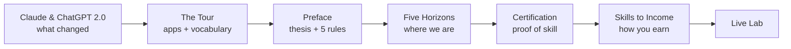

---

## Block 1 · Claude & ChatGPT 2.0 (20 min)

**AI Worker** — an AI system you hand a *whole job* to, within limits you set. It does the work; you check the output.
**"2.0"** — the book's nickname (not a product name) for the shift from *asking questions* to *handing over jobs*.

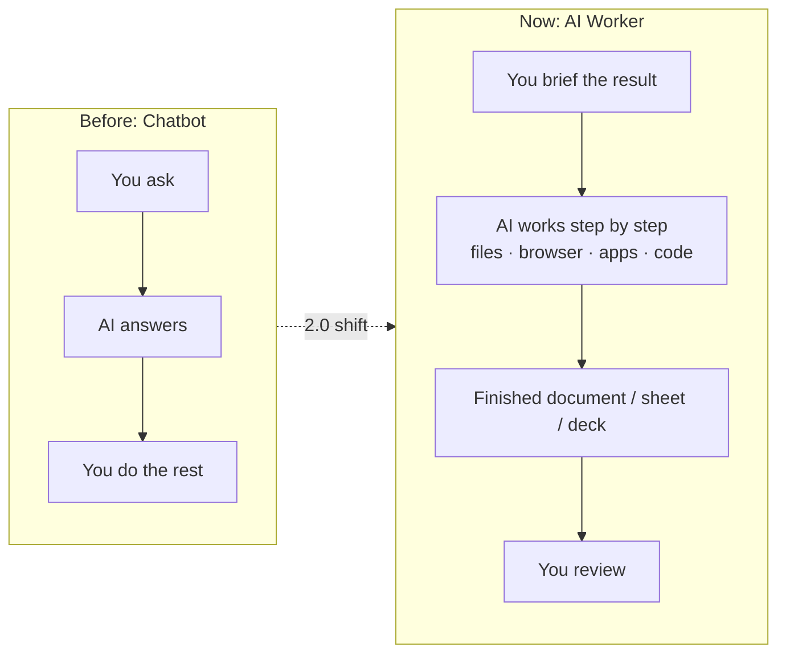

### Where the work happens
- **Cloud jobs** run on an isolated, temporary computer at Anthropic / OpenAI — *"a clean desk every time."* Keep running after you close the laptop.
- **Local files** need the desktop app open.
- Save important results to your account or download them — temporary workspaces are deleted.

### The Four-Part Brief

| Part | Question it answers | Payment-run example |
|---|---|---|
| **Outcome** | What do you want, and how do you know it's done? (**done-when**) | Every invoice due in 7 days marked *pay / hold / ask*; total matches checking program |
| **Format** | What shape is the result? | Spreadsheet: one row per invoice, decision, rule used, what was checked |
| **Inputs** | Which sources? | Invoices folder, payment policy **v3** (not v2), checking program total |
| **Autonomy** | How far may it act alone? | Suggest only. Never approve or send payments |

### One job, start to finish

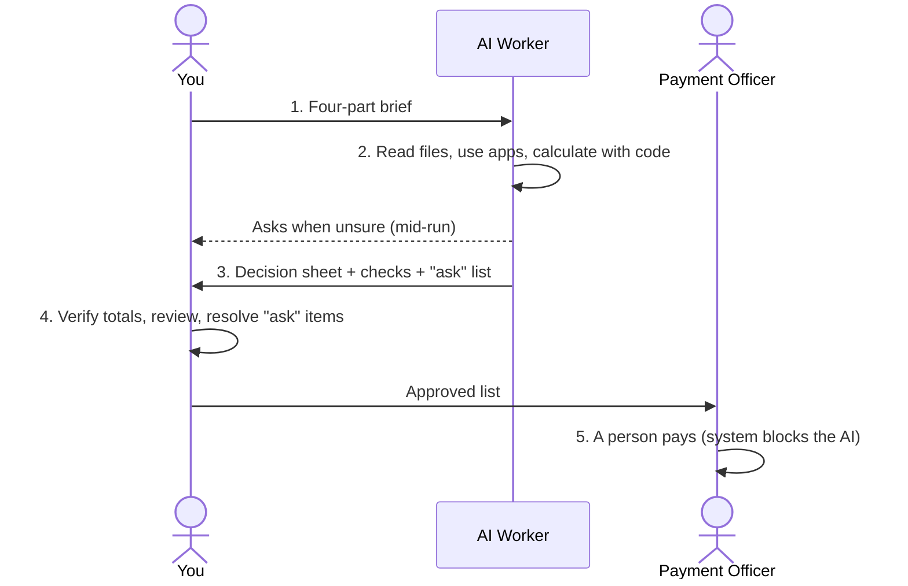

**Ask triggers:** new supplier · needs manager approval · **changed bank details** (common fraud sign).

### What stays your responsibility — 4 rules
1. **Short brief, full rules in a separate document.**
2. **Passing checks = evidence, not permission.**
3. **Briefs guide; permissions enforce.**
4. **Retest briefs when the model changes.**

### How the Panaversity team works

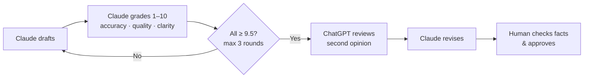

---

## Block 2 · The Tour (15 min)

### Two apps side by side

| | Claude desktop | ChatGPT desktop |
|---|---|---|
| Start a job | Just ask — it decides when a request needs a full job | Turn on **Work** (above the message box) |
| Watch step by step | **Code** tab (no programming needed) | **Codex** |
| Outputs | Docs, slides, designs, more | Docs, spreadsheets, presentations, simple sites |
| Laptop closed | Cloud jobs continue; follow on phone | Same |
| Autonomy | Approve each step, or auto mode with safety check | Set how much it may do + which steps need approval |

### Core vocabulary

| Term | Meaning |
|---|---|
| **AI Worker platform** | App that gives the AI a computer, your files/apps, limits, and ways to check |
| **Model** | The AI itself (e.g. Claude Opus 5.5, GPT-6 Astra) — the app is the program around it |
| **Task** | A job worked step by step, not one reply |
| **Brief** | What you give the AI when assigning a task |
| **Done-when** | The test the AI applies to know it's finished |
| **Context** | Everything the AI holds in mind at once |
| **Connector** | Link to another app (most use **MCP**) |
| **Skill** | Saved instructions for one kind of job, your way |
| **Plugin** | Skills + connectors packaged together |
| **Permission setting** | How much the AI may do before asking |
| **Effort** | How hard the model thinks (slower, uses more plan) |

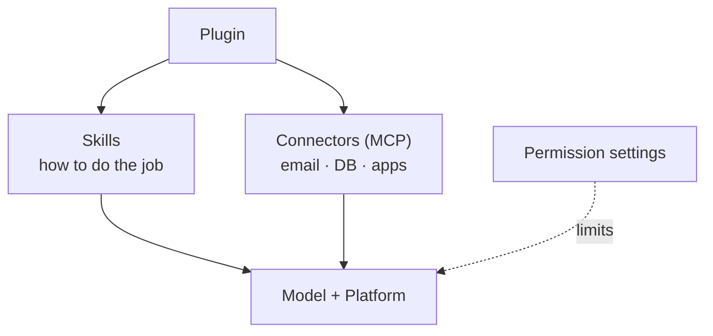

> Product details change monthly. Facts marked *(reported)* come from walkthroughs/news, not vendor docs.

---

## Block 3 · Preface — The Text Box That Became a Worker (20 min)

**Story:** An accounts-payable manager pasted invoices into a chatbot each week → a duplicate **$8,400** invoice was paid twice. Now: **chatbot → delegated task → standing responsibility** (she manages the worker).

### The ladder of interaction

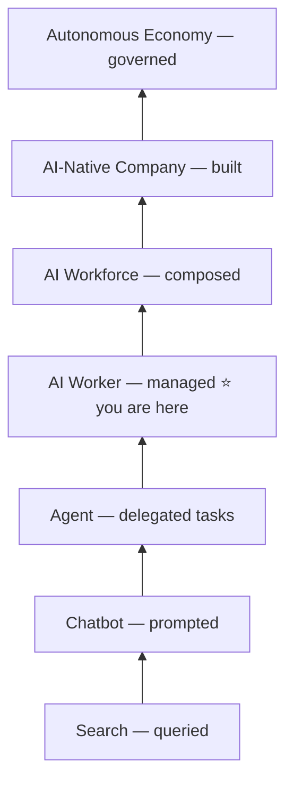

| Term | Definition |
|---|---|
| **Agent** | A model in a loop with tools, repeating until the task is done |
| **AI Worker** | Role-based AI with identity, responsibilities, skills, knowledge, tools, bounded authority, channels, evaluation, continuity |
| **Digital FTE** | An AI Worker at full-time scope in production, with a named business owner |
| **AI Workforce** | Several AI Workers composed under human management |

### The five rules

| Rule | In one line |
|---|---|
| **Ladder** | Search is queried, chatbots prompted, agents delegated, AI Workers **managed** |
| **Operating** | Humans define intent → AI Workers execute → humans verify |
| **Governance** | Three systems of record: KSoR, DSoR, SSoR |
| **Economic** | Don't compete with AI for tasks — build, deploy, govern and manage the workers |
| **Ownership** | Platforms are rented; knowledge and controls are yours |

### The 10-80-10 rhythm

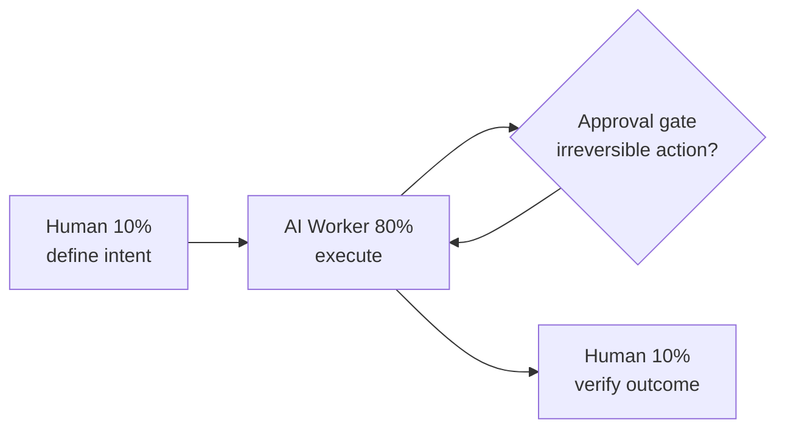

### Three systems of record (governance)

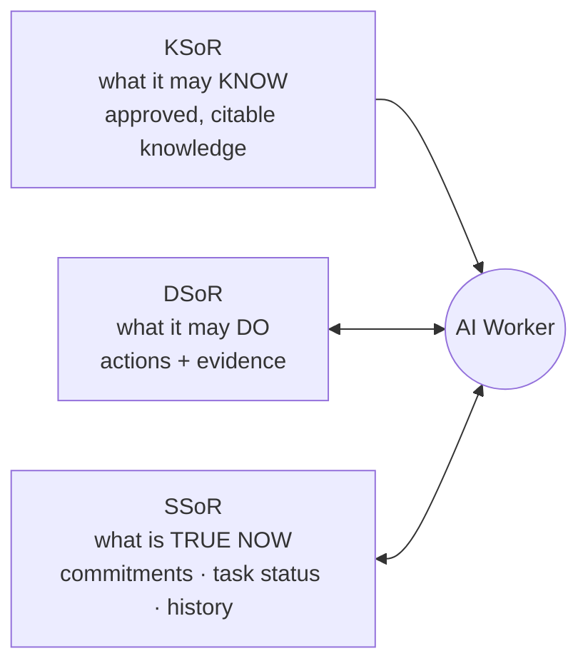

**Trust = trust in the person** (certification, portfolio, references) **+ trust in the worker** (KSoR / DSoR / SSoR).

**✍️ Exercise (2 min):** Pick one weekly task. Write what a worker should **do**, **flag**, **never do**, and **when to ask**.

---

## Block 4 · The Five Horizons (10 min)

> Across every horizon: **humans set purpose, define authority, and remain accountable.**

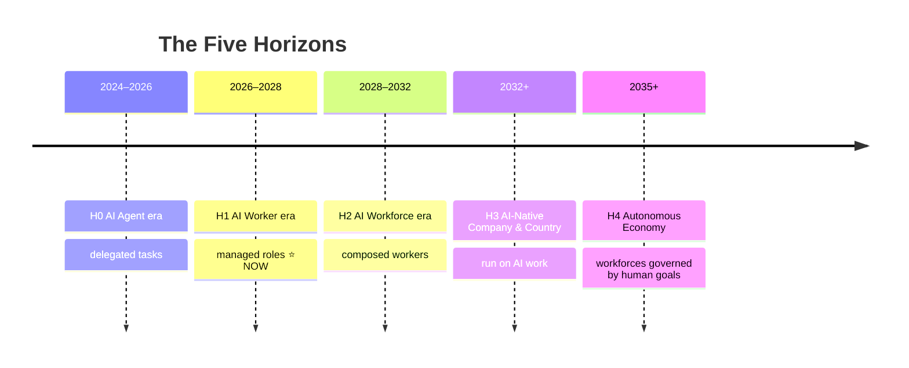

| Horizon | Key challenge |
|---|---|
| H0 Agent | Reliable tools, persistent identity, governed action |
| **H1 AI Worker** | Governed knowledge, clear authority, verifiable output |
| H2 Workforce | Assignment, coordination, management |
| H3 AI-Native | ROI and national capacity |
| H4 Autonomous | Alignment and human accountability |

---

## Block 5 · Certification & Portfolio Roadmaps (10 min)

> **"Certifications are milestones, not the product."** The product is a portfolio an outside reviewer can verify.

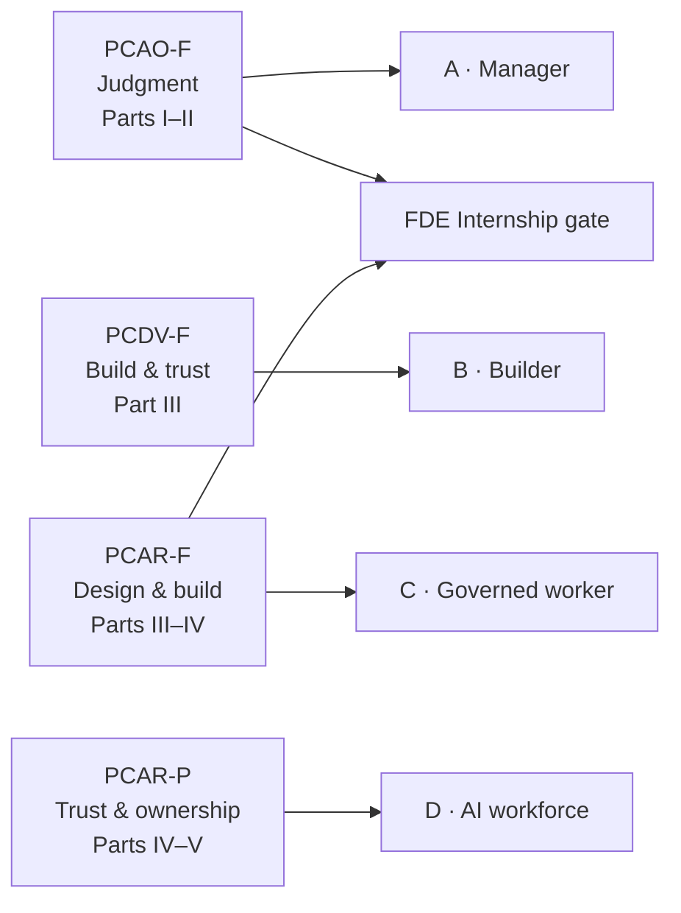

- Optional Anthropic pairs: **CCAO-F, CCDV-F, CCAR-F, CCAR-P** (Claude Partner Network).
- PCxx: pass mark **720 / 1000**, versioned quarterly (e.g. PCAR-F 2026.Q4).
- **Milestone = exam + evidence.** PCDV-F without a plugin ≠ milestone B.
- Later milestones: **E · Market** (vertical, slice, first client), **F · National strategy**.

| Route | Exam | Portfolio exit |
|---|---|---|
| Leader | None | — |
| Everyday professional | PCAO-F | Verified delegated work + Review Contract |
| Domain expert | PCAO-F | Vertical decision + co-built first slice |
| Builder | PCDV-F → PCAR-F → internship | Published plugin on KSoR/DSoR/SSoR + eval suite |

**CCAO-F weights:** Output Evaluation **21%** · Workflow Integration 16% · Governance 15% · Prompting 14% · Product/Model Selection 12% · Configuration & Knowledge 12% · Troubleshooting 10%.

---

## Block 6 · From Skills to Income (10 min)

> Customers pay for **results** — correct work, saved time, fewer errors, better decisions.

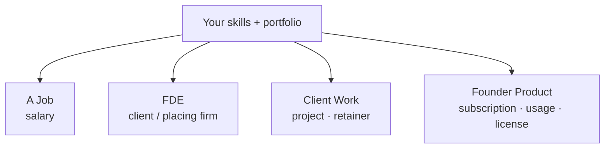

| Route | First milestone |
|---|---|
| Job | Application backed by portfolio work |
| FDE | Pilot inside one client's team |
| Client work | One paid project, delivered and reviewed |
| Founder | Pilot with one paying customer |

### The storefront model
*Interface = storefront · your server = cash register · AI = reasoning.* You sell what the AI lacks: **your knowledge, method, or data.**

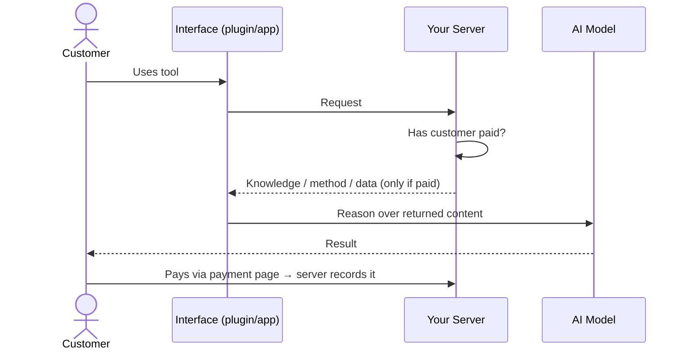

Copying the interface doesn't bypass your server — the value lives there.

---

## Live Lab (15 min)

| # | Task | What students learn |
|---|---|---|
| 1 | Ask a generic question → then give a **four-part brief** with the payment policy attached | Brief ≫ question |
| 2 | Ask Claude to total the office orders **with a program**, then total it yourself in a spreadsheet (watch return order **O-206**) | Check the work, not the claim |
| 3 | Ask Claude whether it can send a payment; inspect connectors and "ask before acting" | Words vs. permissions |
| 4 | 150-word explanation → self-grade → target 9.5, max 3 rounds | Goal-driven improvement loop |

---

## Exit ticket (5 min)

1. What makes an AI Worker different from a chatbot?
2. Name the four parts of a brief.
3. Which enforces a limit — the brief or the permission?
4. Which system of record governs what the worker may *do*?
5. Which horizon are we in now?

Use the **Quiz** tab in [`interactive.html`](./interactive.html).

---

## Resources
- [Claude & ChatGPT 2.0](https://agentfactory2.panaversity.org/claude-and-chatgpt-2/overview/) · [The Tour](https://agentfactory2.panaversity.org/claude-and-chatgpt-2-tour/overview/) · [Five Horizons](https://agentfactory2.panaversity.org/five-horizons/) · [Preface](https://agentfactory2.panaversity.org/preface/) · [Certification Roadmaps](https://agentfactory2.panaversity.org/certification-and-portfolio-roadmaps/) · [From Skills to Income](https://agentfactory2.panaversity.org/from-skills-to-income/overview/)

**Open the interactive companion:** enable GitHub Pages on this repo and visit `/week-01/interactive.html`, or download and open it in any browser.

Content summarised from *The AI Agent Factory* (Panaversity), pages approved Oct–Nov 2026. Product details change monthly — verify against vendor help pages.
