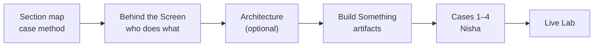
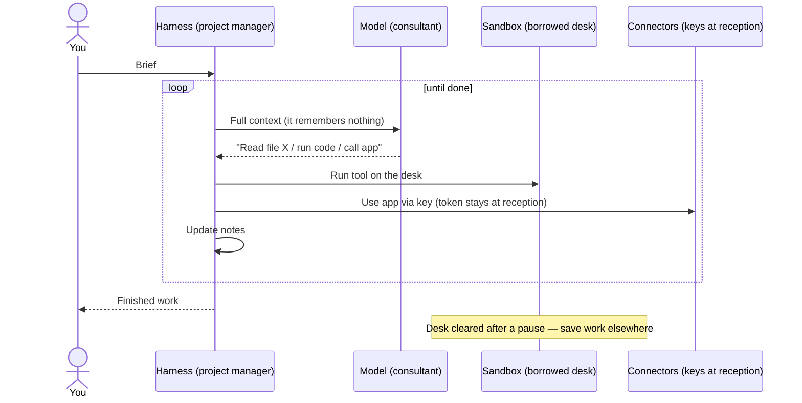
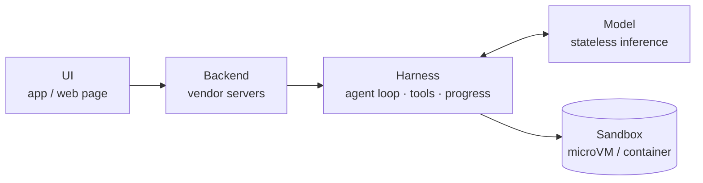
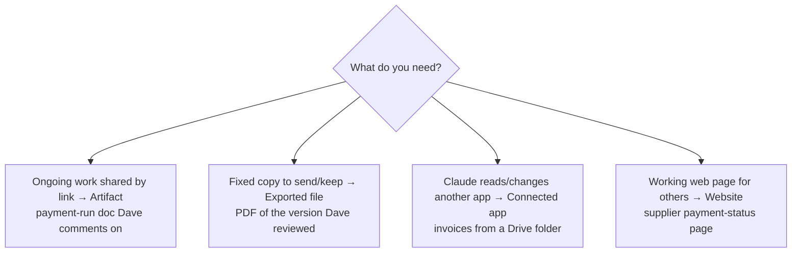
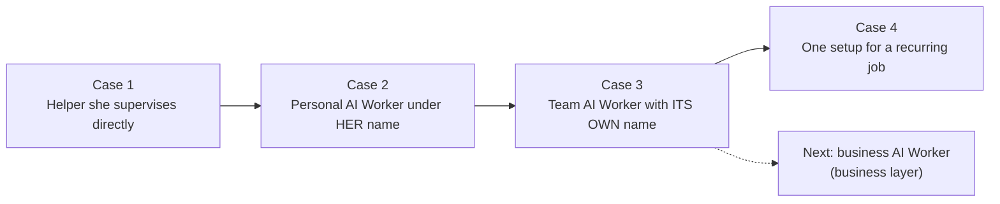

# Week 2 — Behind the Screen, Build Something & Nisha's Four Cases

**NED Agentic AI 2026 · The AI Agent Factory · Part: Claude and ChatGPT 2.0**
**Duration:** 2 hours · **Format:** short talk + case discussion + lab · **Interactive companion:** [`interactive.html`](./interactive.html)

> **One-line thesis:** The model is a brilliant consultant who forgets everything; the harness turns it into a worker. **Permissions — not words — keep a job safe**, and the cases teach the one skill features can't: **judgment**.

---

## Session map (120 min)

| Time | Block | Source page | Key takeaway |
|---|---|---|---|
| 0:00 – 0:10 | Welcome & Week 1 recap | — | AI Worker, Four-Part Brief, "checks are evidence, not permission" |
| 0:10 – 0:20 | **1. The section map & case method** | [overview](https://agentfactory.panaversity.org/claude-and-chatgpt-2/overview/) | 9 sections, 4 cases, why we learn by cases |
| 0:20 – 0:40 | **2. Behind the Screen** | [behind-the-screen](https://agentfactory.panaversity.org/claude-and-chatgpt-2/behind-the-screen/overview/) | Consultant · project manager · borrowed desk · filing cabinet · keys |
| 0:40 – 0:50 | **3. The Architecture** *(optional, technical)* | [architecture](https://agentfactory.panaversity.org/claude-and-chatgpt-2/architecture/overview/) | UI → Backend → Harness → Model; evidence labels |
| 0:50 – 1:10 | **4. Build Something** | [build-something](https://agentfactory.panaversity.org/claude-and-chatgpt-2/build-something/overview/) | Six artifact types + four habits |
| 1:10 – 1:15 | Break | | |
| 1:15 – 1:45 | **5. Nisha's four cases** | [Case 1](https://agentfactory.panaversity.org/claude-and-chatgpt-2/case-1-nishas-ai-team/overview/) · [2](https://agentfactory.panaversity.org/claude-and-chatgpt-2/case-2-nishas-first-client/overview/) · [3](https://agentfactory.panaversity.org/claude-and-chatgpt-2/case-3-nishas-firm/overview/) · [4](https://agentfactory.panaversity.org/claude-and-chatgpt-2/case-4-nishas-month-end/overview/) | Helper → personal worker → team worker → a setup for a recurring job |
| 1:45 – 1:55 | **Live lab** | Case 1 lab | Brief → self-grade → second opinion → human check |
| 1:55 – 2:00 | Wrap-up & quiz | `interactive.html` → Quiz tab | Exit ticket |

---

## Block 1 · The section map & the case method (10 min)

**AI Worker** — an AI system you hand a *whole job* to, within limits you set; you review what it returns.
Example: *review 40 invoices against a bank statement and write a one-page summary — may read files, may not send email.*

**Two audiences, one skill:** use AI Workers **for yourself** (accountant, analyst, manager) or set them up **for clients** as a **Forward Deployed Engineer (FDE)**. What changes is who the work serves and how costly a mistake is.

**Requirements:** Mac/Windows, free Claude + ChatGPT accounts, 18+. No programming. Some labs work best on a paid plan (free steps are given).

### The nine sections (read in order)

| # | Section | Note |
|---|---|---|
| 1 | The New Way of Working | Covered in Week 1 |
| 2 | Tour of the Apps | Optional |
| 3 | **Behind the Screen** | What happens during a job and what keeps it safe |
| 4 | The Architecture | Optional, technical |
| 5 | **Build Something** | Docs, slides, sheets… do **before** the cases |
| 6 | **Case 1 · Nisha's AI Team** | Two AI tools plan a book in one evening |
| 7 | **Case 2 · Nisha's First Client** | A paid job run by an overnight AI Worker |
| 8 | **Case 3 · Nisha's Firm** | A three-person firm sharing an AI Worker in Slack |
| 9 | **Case 4 · Nisha's Month-End** | Combining tools for a monthly report + final assessment |

### Why cases? (six reasons)
1. The hard skill is **judgment**, not button-clicking.
2. Managing an AI Worker resembles **managing a person**.
3. Features change often; **decisions last longer**.
4. Cases give **experience before you have your own**.
5. You can **test your answer in the lab**.
6. An FDE's work **is** a series of cases.

> Feature pages teach tools. Cases build judgment.

---

## Block 2 · Behind the Screen (20 min)

### The team behind the chat window

| Team member | Metaphor | Real component |
|---|---|---|
| 🧠 Consultant | Brilliant, forgets everything after each call — brief every time | **Model** |
| 📋 Project manager | Calls the consultant, keeps notes, does the requested tasks | **Harness** (Claude Code · Codex) |
| 🪑 Borrowed desk | Separate workspace, **cleared** when you stop for a while | **Sandbox** (VM / container) |
| 🗄️ Filing cabinet | Keeps the conversation so you can resume later / on another device | **Backend** |
| 🔑 Keys at reception | Access to other apps — your password is never handed over | **Connectors** (MCP) |

> **The model is a smart helper that forgets between calls. The harness turns it into a worker that remembers and finishes the job.**

### Staying safe: a locked office and a second signature

**Risk — prompt injection:** a web page or email hides instructions (e.g. "send this file to…") — like a fake note slipped to the project manager.

| Protection | What it limits | Example |
|---|---|---|
| 🔒 **Locked office** (sandbox) | **Where** the AI can work — approved sites only, keys kept at reception | Damage is contained if something goes wrong |
| ✍️ **Second signature** (permissions + approvals) | **What** the AI may do — some actions need a person, some are blocked | Brightline's payment system checks approval; the AI Worker cannot pay at all |

- A locked office does **not** make every action safe — connectors can still send an email. You need **both**.
- Paying, sending, deleting → **always need approval**, checked by **the system that performs the action**, not just the AI.

**Two habits:** ① Never paste real passwords or secret keys into a chat — use connectors. ② Share only the folders the task needs.

---

## Block 3 · The Architecture *(optional, 10 min)*

- What changes between web, desktop and terminal is mainly **where the harness runs**: cloud sandbox, your device, or a server you manage.
- Each **session** gets its own sandbox, created at start, destroyed at end. Each **scheduled task** run starts a new session (except inside a project).
- **Worker principal** — the identity a worker acts under. **Business layer** — identity, durable records, enforced authority, audit.

| Evidence label | Meaning |
|---|---|
| Observed | Seen directly in the examined Claude session |
| Reported by ChatGPT | ChatGPT's report of its own tools, not independently reviewed |
| Tool-documented | In the session's tool descriptions, not seen in action |
| Vendor-documented | In Anthropic / OpenAI public docs |
| Inferred | The authors' conclusion |
| Unknown | Not visible and not documented |

---

## Block 4 · Build Something (20 min)

**Artifact** — finished work (doc, deck…) that opens beside the chat; editable, revisitable, shareable; lives in the **Artifacts tab** so it survives the cleared desk.
**Export** — a fixed snapshot file (Word/PDF) that does **not** update when the artifact changes.

**Setup:** Settings → Capabilities → turn on **Artifacts** and **Create and edit files** → Artifacts tab → *Make something new* → pick a tile.

### Six artifact types

| Type | Use it for | ChatGPT equivalent | Claude plan |
|---|---|---|---|
| **Docs** | Document people read and edit | Pages (Space) | Free |
| **Slides** | A deck to present | Slides (Space) | Free |
| **Design** | Output judged by how it looks | Sites | Free |
| **Sheets** *(beta)* | Shared table with formulas | Inside Excel / Google Sheets | Paid |
| **Data** | Charts from company data (formerly Dashboards) | @Data plugin (Work) | Paid |
| **Whiteboard** *(beta)* | Shared board for thinking together | None yet | Paid |

### The four habits
1. **Request the right kind** — purpose, audience, tool. Need Word? Make the artifact, check it, export **last**.
2. **Refine collaboratively** — small fixes yourself; big revisions to the AI.
3. **Share deliberately** — new artifacts are private; you choose who sees what.
4. **Verify before release** — numbers, names, facts; remove private info; would a reader understand it without your chat?

⚠️ Artifacts reading connected apps show **each viewer their own data**, but data already copied in is visible to everyone. Shared pages can hide AI-manipulating text — open only trusted ones.

### Artifact, file, connected app, or website?

> The PDF is a copy — **the approval itself needs its own record** (e.g. sign-off in the payment system).

---

## Block 5 · Nisha's four cases (30 min)

Nisha is a (fictional) chartered accountant in Karachi. Each case raises her responsibility — and the cost of a mistake.

### Case 1 · Nisha's AI Team — plan a book in one evening
- Book: *The Bilingual Accountant: Moving Between IFRS and US GAAP*. Based on a real exercise run on 8 Nov 2026.
- Claude drafts and **grades itself** (accuracy · quality · ease), rounds until all ≥ 9.5; ChatGPT gives a **second opinion**; Nisha makes the **final call**.
- Grades: **7 / 6.5 / 7 → 9.5 / 9.5 / 9.3** after three rounds. Claude stopped below target on *ease* because only real readers can test it — it didn't inflate its score.
- Unverified US GAAP topic numbers **19 → 2**; sources **4 → 9**. 6 draft files, final = version 6.
- **Lessons:** every job starts with a brief · self-grade + second reviewer · a person decides · save files outside the chat · keep a diary.

### Case 2 · Nisha's First Client — an overnight AI Worker
- First paid job: a short **IFRS → US GAAP bridge** for a foreign buyer; the AI Worker runs while she sleeps.
- **Thursday night:** client wants the final bridge by 6 p.m. New York (4 a.m. Karachi) **and** nightly emails straight from the worker. The **lease line is unchecked** — contract not yet received.
- Operating lease → bridge ends at **Rs 103.2 m**; finance lease → **Rs 102.0 m**.

| Draft | Trade-off |
|---|---|
| Say yes to both | Emails come from **her** address — client can't tell what she actually read |
| Keep the second signature (send checked lines now, lease Monday) | Safe, but may lose the client — board meets in the morning |
| Send all, lease flagged as unchecked | Would a board notice a footnote? |

**Lesson:** the worker can do the work while you sleep; it **cannot decide what goes out under your name**.

### Case 3 · Nisha's Firm — a team worker in Slack
- Firm of three (Nisha, Sana, Hamza); client Lakeshore Supply. The worker joins Slack with **its own name and accounts** (Claude Tag, public beta).
- **The Friday send:** approved Wednesday, Nisha flies Friday, the file doesn't leave the firm — nobody else can approve. Monday the client asks: *who can release a file while Nisha is away?*
- **Lessons:** own identity ≠ acting under a person · **words are not locks** · a **skill teaches a method but can't guarantee an outcome** · in a firm, the question becomes *which* person's yes counts.

### Case 4 · Nisha's Month-End — one setup, every month
- Monthly client report took a junior **two days**; with the setup, about **two hours** of people's time (examples, not measurements).
- Setup = **project** (client rules) + **skill** (firm method) + **connected drive / local folder** + **matching program on a cloud computer** + **artifacts** (sheet, memo, slides, cover) + **scheduled "morning check"** by the Slack worker.
- Wednesday: the morning check catches **changed bank figures** → rerun → reviewer approves.
- Reconciliation: **$201,480.00 + $6,120.00 − $9,300.00 = $198,300.00**.
- **Friday's decision:** same work for 4 companies × (1 month-end + 4 weekly) = **20 packs**, some straight to the bank, for less money.
- **Lesson:** when something breaks, **fix the setup, not the single result**. *"Build the setup once, and it does the job again. Your judgment is still yours."*

---

## Live Lab (10 min) — Take Nisha's method to 2.0

| # | Step | What students learn |
|---|---|---|
| 1 | Write a four-part brief for a one-page outline in your field | Every job starts with a brief |
| 2 | Ask Claude to grade it (accuracy · quality · clarity), revise to 9.5, max 3 rounds | Goal-driven self-review |
| 3 | Paste the result into ChatGPT for a second opinion | A second reviewer catches different things |
| 4 | You check facts and decide; save each version as a file (Docs artifact) | Second signature + save outside the chat |

---

## Exit ticket (5 min)
1. In the team picture, who is the model — and why must it be briefed every time?
2. Locked office vs. second signature: which limits *where*, which limits *what*?
3. Which artifact type for a shared table with formulas?
4. Why was "say yes to both" risky for Nisha in Case 2?
5. In Case 4, when something goes wrong, what do you fix?

Use the **Quiz** tab in [`interactive.html`](./interactive.html).

---

## Resources
- [Claude & ChatGPT 2.0 — overview](https://agentfactory.panaversity.org/claude-and-chatgpt-2/overview/) · [Behind the Screen](https://agentfactory.panaversity.org/claude-and-chatgpt-2/behind-the-screen/overview/) · [The Architecture](https://agentfactory.panaversity.org/claude-and-chatgpt-2/architecture/overview/) · [Build Something](https://agentfactory.panaversity.org/claude-and-chatgpt-2/build-something/overview/) · [Tour of the Apps](https://agentfactory.panaversity.org/claude-and-chatgpt-2/tour/overview/)
- Cases: [1 · AI Team](https://agentfactory.panaversity.org/claude-and-chatgpt-2/case-1-nishas-ai-team/overview/) · [2 · First Client](https://agentfactory.panaversity.org/claude-and-chatgpt-2/case-2-nishas-first-client/overview/) · [3 · Firm](https://agentfactory.panaversity.org/claude-and-chatgpt-2/case-3-nishas-firm/overview/) · [4 · Month-End](https://agentfactory.panaversity.org/claude-and-chatgpt-2/case-4-nishas-month-end/overview/)

Summarised from *The AI Agent Factory* (Panaversity), pages approved 9–13 Nov 2026. Cases are fictional teaching cases; some exhibits are illustrative and some practicals not yet run. Not accounting advice. Product details change monthly — verify against vendor help pages.
