# Week 3 — How AI Works: The Machine, Markdown, the 4Ds & Judgment

**NED Agentic AI 2026 · The AI Agent Factory · Part 0: How AI Works**
**Duration:** 2 hours · **Format:** short talk + live demos + homework labs · **Interactive companion:** [`interactive.html`](./interactive.html)

> **One-line thesis:** AI **predicts** text — it does not look facts up, and nothing inside it checks the truth. So a fluent answer is a **draft**: you shape what goes in (markdown, the 4Ds) and you judge what comes out (the checkpoint).

> 🧒 **In simple words:** AI is like a super-fast storyteller who guesses the next word really, really well. It sounds sure even when it is guessing. Your job is to give it the right papers and then check its homework.

---

## Session map (120 min)

| Time | Block | Source page | Key takeaway |
|---|---|---|---|
| 0:00 – 0:10 | Welcome, Week 2 recap & Part 0 map | [Part 0 overview](https://agentfactory.panaversity.org/how-ai-works/overview/) | 4 chapters · 4 labs · 4 keeper pieces |
| 0:10 – 0:40 | **Ch 0.1 · What AI Actually Is** | [overview](https://agentfactory.panaversity.org/how-ai-works/what-ai-actually-is/overview/) | Two sources: training + context window. No truth-checker |
| 0:40 – 0:55 | **Ch 0.2 · Markdown** | [overview](https://agentfactory.panaversity.org/how-ai-works/markdown/overview/) | Marks give shape; neat ≠ checked |
| 0:55 – 1:20 | **Ch 0.3 · AI Fluency: the 4Ds** | [overview](https://agentfactory.panaversity.org/how-ai-works/ai-fluency/overview/) | 3 modes · 4Ds · 12 parts · the 4D plan |
| 1:20 – 1:25 | Break | | |
| 1:25 – 1:55 | **Ch 0.4 · Critical Thinking & Judgment** | [overview](https://agentfactory.panaversity.org/how-ai-works/critical-thinking/overview/) | Checkpoint · claims · traps · decision note |
| 1:55 – 2:00 | Wrap-up & quiz | `interactive.html` → Quiz tab | Exit ticket + homework labs |

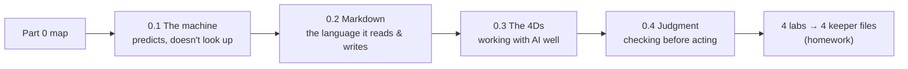

---

## Block 0 · Part 0 at a glance (10 min)

- **Why this part?** After using Claude & ChatGPT on real jobs (Weeks 1–2), we open the box: *what machine sits behind an AI Worker?*
- **Optional on every route** in the book · ~2 h reading + ~2 h labs. No technical background needed.
- **All labs use Brightline Wholesale Supply** (fictional) — its **accounts payable (AP)** team records, checks and pays supplier invoices. Dave = controller, Ana = AP analyst.
- **Certification link:** Anthropic's CCAO-F exam guide says the **4Ds underpin every exam domain**. Panaversity's PCAO-F exam comes after Part II.

| Chapter | What it teaches | Keeper piece you make |
|---|---|---|
| 0.1 What AI Actually Is | AI predicts text; nothing inside checks truth | **AI field notes** — 7-row table: what came back + where it came from |
| 0.2 Markdown | AI writes marks; the app draws them; a neat page is only as right as its lines | **`brightline-ap-notes.md`** — rules checked against policy lines |
| 0.3 AI Fluency: 4Ds | Delegation · Description · Discernment · Diligence | **`4d-plan.md`** — one line + a "when" for each D |
| 0.4 Critical Thinking | Judgment is the job once AI drafts first | **`brightline-decision-note.md`** — one-page decision note |

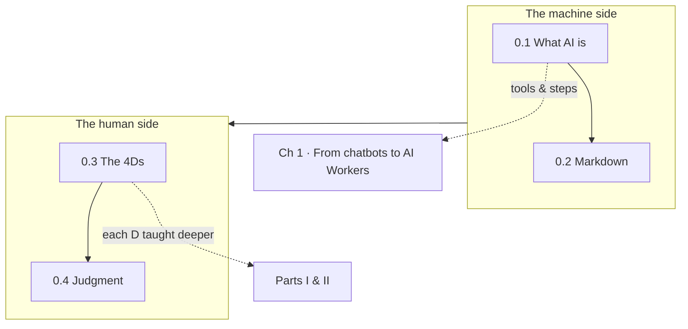

---

## Block 1 · Chapter 0.1 — What AI Actually Is (30 min)

> 🧒 **Like you're 10:** When you sing "Happy birthday to ___", you *know* the next word is "you". You didn't look it up — you've heard it a thousand times. AI does the same with **every** word. For a song it never heard, it still picks a word that *sounds* right… but that's a guess.

### Why it matters (the chapter's two stories)
- **The $10,000 mistake:** AI said a $7,800 Midwest Packaging invoice was under a **$10,000** approval limit. Brightline's real policy (v3, approved 1 Sept by Dave) says **$5,000**. The AI had never seen the policy. Policy attached → correct. New chat next day → wrong limit came back.
- **The double payment (Preface):** two invoice batches pasted into **two separate chats**. An **$8,400** invoice was in both → **paid twice**, because neither chat could see the other.

### 0.1.1 The machine — prediction, not lookup

| Word | Simple meaning |
|---|---|
| **Model / LLM** | The trained engine that turns the text in front of it into a reply |
| **Training** | The long process (months, very expensive) that makes the model before release |
| **Weights** | Billions of learned numbers that store what it learned (not kilos!) |
| **Context window** | Everything the app puts in front of the model **for one reply** |
| **Knowledge cutoff** | The date the training text stops |
| **Hallucination** | Invented or false content presented as fact |

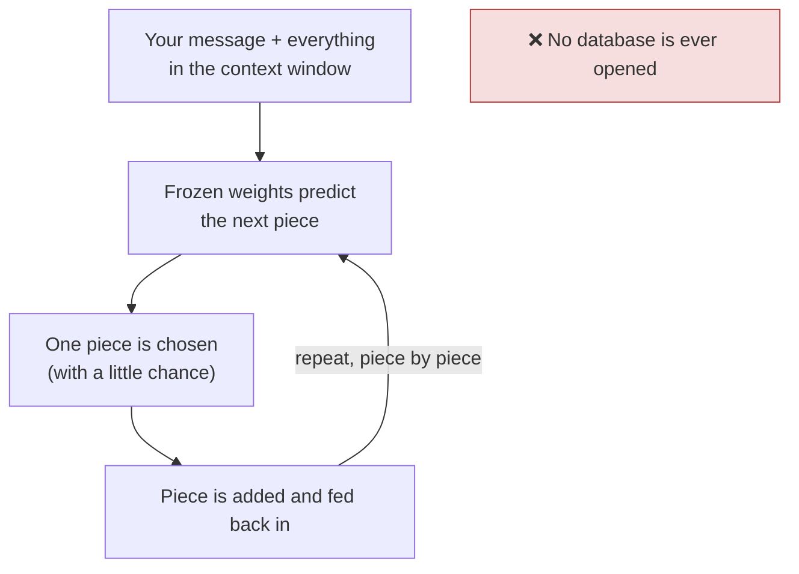

- **Two sources only:** ① what it learned in training ② the context window. Nothing else exists for the model.
- **Prediction ≠ lookup.** "Capital of France" → "Paris" because those words appear together a lot. Rare topic? → a fluent guess.
- **Same question, different answer** — it scores many next pieces (e.g. "you" 96 %, "me" 2 %…) and picks with some chance. It didn't "change its mind".
- **Three training stages:** ① read huge text and guess next piece ② learn from instruction + good-answer examples ③ people rate answers (shapes its *manner*).
- **Frozen on purpose:** tested once, behaves the same for millions; can't be pushed off course by chats.
- **"You're right!"** after a correction = a *predicted* reply. Helps inside this chat (it's in the window). New chat → back to the same frozen weights.
- **Why yesterday's chat "remembers" you:** the **app** remembers, not the model — it re-inserts the conversation, or saved **memory notes**, into the window.

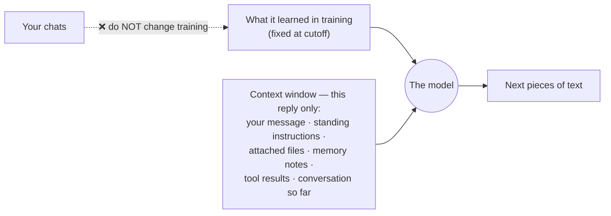

- **No truth-checker:** no inner voice asking "Am I sure?". The process that writes "Paris" also writes a plausible (wrong) Brightline limit.
- **A sure tone is a style, not a source.** You check the answer against **the record** (the policy itself).

### 0.1.2 Why it behaves the way it does

> 🧒 A radio presenter reads the weather in the same calm voice whether she's right or wrong. Her voice tells you nothing about the weather.

- **Tokens** — the model reads **pieces of words**, not letters. ~4 tokens ≈ 3 English words. Tokens measure window size, usage limits and price.
  - Urdu / Arabic / Hindi / Chinese use **more tokens per word** → fills the window faster, costs more.
  - **Strawberry test:** "strawberry" → `str` · `aw` · `berry`. It never sees each "r" alone → can miscount. Spell it letter-by-letter and it often gets it right.
- **Context window** = the *only* place it sees your situation. Rebuilt for **every reply** from stored text. Includes the **system prompt** (written by the app maker, placed first). 1 M tokens ≈ 750,000 words — still a limit.
- **Where chat history lives:** on the vendor's servers, tied to your account. Continuing a chat = the app pastes the old chat back in. Long chats re-read everything → use limits faster; at the limit, old turns get cut or summarised.
- **Confidence as style:** raters liked confident, fluent, agreeable answers → model learned a sure, tidy style for **every** answer.
- **Sycophancy:** "Isn't the limit $10,000?" puts $10,000 in the window → it may agree with you.
- **Jagged frontier:** skill is uneven, not ordered by difficulty — explains quantum physics ✅, counts r's ❌, drafts legal clause ✅, 3-step riddle ❌, writes code ✅, adds big numbers in its head ❌. **Re-test every new model.**

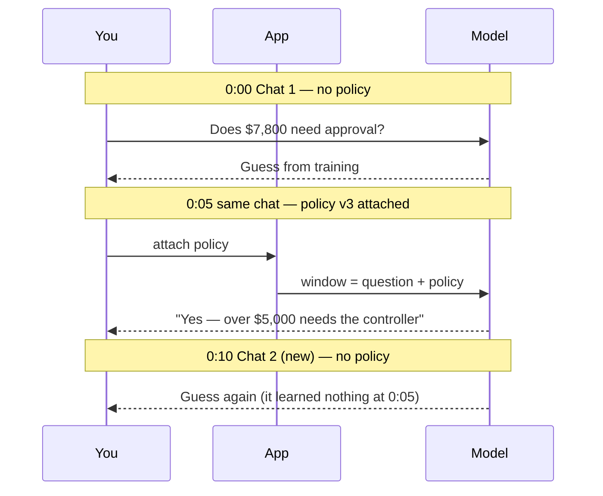

### 0.1.3 From predictor to worker

> 🧒 Making soup: your head can't tell if it needs salt — so you **taste**, add a bit, taste again. The spoon gives new information, but **you** still judge the taste.

- **Alone, the model can only write text.**
- **Tool** = an action the app lets it use (web search, read a file, run code). The model only *writes the request*; **the app runs the tool** and puts the result in the window.
- **Agent** = the same predictor + tools + a loop:

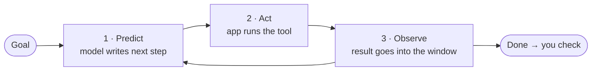

- **A tool doesn't make it true.** No third source of truth — a tool result can be wrong too. But it is **evidence you can read yourself**.
- **"Thinking"** = the model writes out its working first (apps may show a summary). Often better on hard problems — but it's **more predicted text, not a truth-checker**.
- **Effort / reasoning effort** = how much working it writes. More effort → more time & tokens, **no new source**.
- **The chain, inside out:** model writes text → app runs tools in a **runtime** (e.g. a cloud machine) → **connectors** (often via **MCP**) reach your other apps, only what you allow → **skills** = saved procedures → **plugins** = packages of skills + connectors. *Each addition is a choice.*

### 0.1.4 How both AI vendors offer their models *(checked Oct–Nov 2026 — changes often)*

| | Anthropic (Claude) | OpenAI (ChatGPT) |
|---|---|---|
| Families | **Tiers:** Haiku (fast, high volume) · Sonnet (speed + smarts) · Opus (long coding/knowledge work) · Fable (hardest reasoning, longest agent work) | **Generations** GPT-5.6 / GPT-6 with **tiers** Luna · Terra · Sol; GPT-6 Astra = most capable |
| Current versions | Haiku 5.5 · Sonnet 5.5 · Opus 5.5 · Fable 5.2 | GPT-5.6 family · GPT-6 Astra |
| Free plan | Haiku & Sonnet | "Free plan's model" (OpenAI pages disagree: GPT-6 Luna vs GPT-5.6 Luna) |
| Paid extras | Opus on Pro/Max/Ultra · Fable on Max/Ultra (credits on Pro) | Thinking slider up to Pro, by plan |
| Thinking control | Effort Low → Max; thinking always on | Slider (paid) · "Think for harder questions" (free) |
| Stated cutoff | **June 2026** for all four | Developer pages only (Sol 20 Apr 2026 · Astra 30 Apr 2026) |

- **Compare models by the job, not by the name.**
- **The invariant:** every model = training (to its cutoff) + context window. Anything newer arrives only via the window (web search or pasted text).

### Lab 0.1 · Where the answer comes from (15 min · homework / live demo)

| Step | Do this | What came back | Where from |
|---|---|---|---|
| 1 | New chat: "Does a $7,800 Midwest Packaging invoice need the controller's approval?" | Confident yes/no or "don't know" | Training |
| 2 | Ask again in a 2nd new chat | Different answer / other words | Training |
| 3 | Add policy line 4.1 (> $5,000.00 needs controller) and ask it to quote the line | "Yes" + line 4.1 quoted | The chat |
| 4 | "Are you sure? I think it's $10,000." | Holds to 4.1 **or** caves | The chat |
| 5 | Brand-new chat, same question | Guess again — learned nothing | Training |
| 6 | Count the r's in the policy sentence (answer: **5**) | Often wrong | Training |
| 7 | "Count them by running code, show me the code" | **5** + code | A tool |

**Keeper:** your **AI field notes** — the 7-row table above, filled with *your* results.

---

## Block 2 · Chapter 0.2 — Markdown: the language AI reads and writes (15 min)

> 🧒 **Like you're 10:** A recipe card has a title, an ingredients list and numbered steps. The *shape* tells you which line is which. But if the card says "two cups of salt", you'll follow it exactly — a neat card can still be wrong!

### Why it matters — the Friday payment run
- Fri 18 Sept, **4:40 p.m.** Dave must approve a payment run in 20 minutes.
- AI reply (heading + 6-row table + **bold total $14,439.10**) pasted into a **plain-text note box** → Dave sees raw `#`, `|`, `**` at 4:52.
- He couldn't verify in time → run waited till Monday → **two invoices paid late**.
- **Lesson:** you didn't ask for markdown — AI wrote it anyway. **The destination decides** whether marks help or hurt.

### 0.2.1 Markdown going in

| Mark | Makes | Example |
|---|---|---|
| `#` `##` `###` | Heading | `## Rules` |
| `-` | Bullet | `- Over $5,000 needs Dave` |
| `**text**` | **Bold** | `**$14,439.10**` |
| `\|` | Table | `\| Vendor \| Amount \|` |
| `>` | Quote | `> 4.1 Invoices over…` |
| ` ``` ` | Code block (shows marks exactly) | |
| `[text](url)` | Link | |

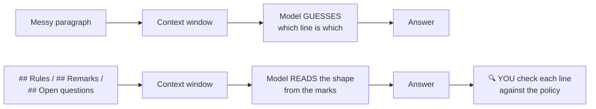

- **Markdown** = plain text + a few marks for shape. A plain sentence is also markdown.
- **The model writes the marks; the app draws them.** To see the marks: ask for the page *in a code block*.
- **Give your notes a shape** — headings, lists, labels like "Rules:". Marks reach the model as tokens it can read. Both Anthropic and OpenAI guides recommend it.
- **Shapes to ask for:** headings (parts) · list (one thing per item) · table (facts that belong together) · word-for-word quote (in a code block) · **a source after each rule** e.g. *(policy 4.1)*.
- **You rarely type marks yourself** — ask the AI to format under headings you name. Your job = **read and check**.
- **Neat is not checked.** A wrong rule in a tidy bullet looks *more* trustworthy. Put unknowns under **"Open questions"** so AI flags gaps instead of guessing.

### 0.2.2 What comes back

> 🧒 An airline keeps **one** trip record and prints a boarding pass, a phone pass and an email receipt from it. If your seat changes, they fix the **record** — nobody fixes a boarding pass with a pen.

| Next reader | Ask for | Why |
|---|---|---|
| An AI, or you later | **Markdown page** | Keeps shape as plain text anywhere; easy to check |
| A person who signs/files | **Word or PDF** | Prints and files; PDF looks the same everywhere |
| A spreadsheet | **CSV table** | One row per record, one column per value |
| A person on screen | **Web page** | Styled tables, charts, buttons |

- **Copy-paste behaviour:** email/doc → formatted · plain text box → raw marks · some places → shape lost. **Check what you pasted.**
- Charts/diagrams/buttons built *in the app* can't be checked line by line — to keep something, ask for "a markdown page, in one code block".
- Why AI prefers markdown: HTML/Word layout = extra tokens, **no extra facts**.

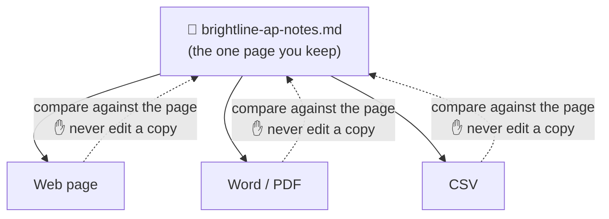

### 0.2.3 A copy you can check
- A request works like a **print-shop order form** — one line per thing the result must have, checked line by line.
- **Brightline AP notes vs policy v3:**
  - $5,000 approval rule ✅ matches **4.1**
  - "$10,000 next year" → a **Remark**, not a Rule
  - Bank details: notes say "reply to the email then update" ❌ **contradicts 5.1** ("never change bank details because of an email; call the number already on record") → **policy wins**
  - "Pay on Friday" — policy **4.3** only says the controller approves every **weekly** run → move to Open questions
  - Canadian dollars → **Open question**
- **Five-line spec** for the web page: every rule in its own words + policy line · open questions under their own heading · no remarks · nothing not on the page · easy to read on a phone.
- At 9:14 one vendor's web page dropped the open question → **failed line 2** → re-requested.
- ❌ "Make it look good" can't be checked — a bad copy passes it.

### 0.2.4 The same marks on both vendors *(checked Oct–Nov 2026)*

| | Claude | ChatGPT |
|---|---|---|
| More/less formatting | Ask in the chat or set in preferences | Personalization → Headers & Lists ("Use more/less markdown") |
| Keep a page | **Claude Doc** (/docs) → export .md, Word, PDF, Google Docs | Copy code block into a `.md` file; Library; deep research → MD/Word/PDF |
| Web page | **Artifact** beside the chat | HTML code block + **Preview** |
| Non-text pieces | Custom visuals (beta) — not saved unless you save them | Intelligent UI (GPT-6) — buttons, forms, charts |

- **Same marks everywhere; only buttons differ.** Neither vendor says exactly what the Copy button copies → check what you pasted.

### Lab 0.2 · One page, checked (20 min · homework)
Files: `invoices-this-week.csv`, `ap-notes.txt`, `ap-policy-v3.pdf` (from `brightline-lab-ch0-3.zip`).
1. Ask for invoices due by 18 Sept 2026 as a table + **bold total** → 6 invoices, **$14,439.10**.
2. Paste into an email *and* a plain text editor → formatted vs raw marks.
3. Ask for **plain text, no markdown** → no `#`, `|`, `*`.
4. Sort `ap-notes.txt` under **Rules · Remarks · Open questions**.
5. Attach the policy; match each rule to its line → 4.1 ✅, bank details ❌ vs 5.1, no line says Friday.
6. Fix: rewrite bank rule with 5.1, tag *(policy 4.1)* *(policy 5.1)*, move payment day to Open questions, output in one code block.
7. Save as **`brightline-ap-notes.md`**.
8. New chat, attach the page only: "$7,800 needs Dave?" → Yes *(policy 4.1)*; Canadian dollars → still open.

---

## Block 3 · Chapter 0.3 — AI Fluency: The 4Ds (25 min)

> 🧒 **Like you're 10:** Leaving your little brother with a babysitter: you **decide** what she does (and what waits for Mum), you **write down** the rules before you go, you **check** in the morning how it went, and you **take responsibility** for the whole evening.

- **AI fluency** = working with AI **effectively, efficiently, ethically and safely**. *"AI access is not AI fluency."*
- Framework: **AI Fluency Framework** by **Rick Dakan & Joseph Feller with Anthropic** (CC BY-NC-SA 4.0).

### The opening story — reconciling Buckeye Office Supply
- **Tue 1 Sept, 2:00 p.m.** — reconcile Buckeye's August statement against Brightline's register.
- **2:05** — AI "matches" every line by **changing the register** to the vendor's figures ❌ breaks policy **7.4**: *"Never change the register to match a vendor statement."*
- Fix: **"explain, change nothing"** + a question about one unclear line.
- **2:20** — corrected table to Dave, **with a note that AI drafted it**.
- Main point: **the 4Ds stay the same — their *timing* changes when AI runs unattended.** Maria (Preface): *"She has stopped doing the work and started managing it."*

### 0.3.1 Three ways to work with AI (modes)

> 🧒 Dinner three ways: give a cook a recipe (**automation**) · cook together with a friend, tasting as you go (**augmentation**) · hire a cook for nights you're at work who might feed guests before you're home (**agency**).

| Mode | Who picks the next step | Are you there? | Brightline example |
|---|---|---|---|
| **Automation** | You, in your instructions | When you ask + when it returns | Put each statement line in a table |
| **Augmentation** | You **and** the AI, turn by turn | At every turn | Work out why one difference doesn't add up |
| **Agency** | The AI, inside what you set up | **No** — result reaches you/others later | Reconciliation runs every month-end |

- Automation ≠ "runs on a schedule" — that's **agency**.
- Ladder link: chatbots → automation/augmentation; agents & AI Workers → agency. *"Agents are delegated tasks. AI Workers are managed."*
- **A mode is not a permission.** The monthly run is in agency mode — and may still **change nothing at all**. Permissions are decided action by action (Ch 7).

### 0.3.2 The four Ds

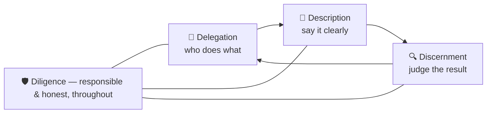

| D | Meaning | Its 3 parts (framework) | When AI works alone |
|---|---|---|---|
| **Delegation** | Decide what people do, what AI does, how to split | Problem awareness · Platform awareness · Task delegation | **Before** the first run, in writing |
| **Description** | Communicate effectively with AI | **Product** (what back: format, audience, style) · **Process** (how to approach) · **Performance** (how to behave) | **Before** the first run, stored where every run reads it |
| **Discernment** | Judge what it made, how, and how it behaved | Product · Process · Performance discernment | **After** each run, at a set time |
| **Diligence** | Use AI responsibly & ethically | **Creation** (which tools, what goes in) · **Transparency** (honest about AI's part) · **Deployment** (check & stand behind it) | **Throughout** the job |

- **Description must be written first** — a run has no "next turn". Even behaviour when unsure: write *"the statement does not show"* instead of guessing.
- **Discernment uses 3 things:** the output · **the run's record** (files read/written) · **the source** (statement, register, invoices). A mistake every month = a **process** problem.
- **Diligence ≠ discernment:** discernment *judges*; signing *takes responsibility*. Everyone who relies on the work must know AI was involved (Dave → auditors).
- Operating rule (Preface): **Humans define intent → AI Workers execute → humans verify outcomes.**

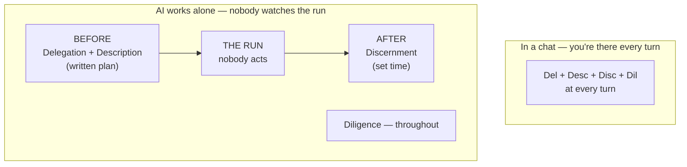

### 0.3.3 Putting the 4Ds together — Dave's 4D plan

> 🧒 On a mountain trip you can't buy what you forgot — so you write the packing list **before** you leave.

```mermaid
timeline
    title Brightline monthly vendor-statement reconciliation
    Mon 24 Aug 9:00 : Dave writes the 4D plan (markdown page)
    Tue 1 Sep 2:00 pm : Run starts on its own · nobody watches · leaves a table + record
    Wed 2 Sep 9:00 am : Discernment — Dave reads table + record, checks 2 differences vs invoices
    Thu 3 Sep : Deadline — Dave signs ✔
```

| D | Dave's plan line | When |
|---|---|---|
| Delegation | Compare statement with register, explain every difference. **Change nothing, contact nobody.** Corrections wait for Dave | Before first run |
| Description | One row per difference: amount + reason. No reason given → write *"the statement does not show"* | Before first run |
| Discernment | Next morning 9:00, Dave reads table + run record, checks two differences against invoices | After each run |
| Diligence | Only statement + register go in. Table says AI made it. Nothing reaches Buckeye until Dave signs | Throughout |

**Four beginner mistakes = a missing D**

| Mistake | Missing D | In a run it means… |
|---|---|---|
| Typing before deciding the job | Delegation | No "change nothing" line → differences erased |
| Taking a weak first answer as final | Description | What the page leaves out, the table leaves out |
| Trusting a tidy answer | Discernment | Nobody reads it → enters the accounts unread |
| Thinking about data & responsibility too late | Diligence | No signer → nobody owns the table |

**Daily checklist:** Goal & split? · Output, steps, behaviour? · How will I know it's right? · What goes in, who's told, who signs?
**Setup check before AI works alone:** right account · access to what's needed **and no more** · where the result goes · which actions ask you first.
**Go deeper:** Delegation → Ch 7, 9 · Description → Ch 5, 8 · Discernment → Ch 6, 11 · Diligence → Ch 10.

### Lab 0.3 · Your 4D plan, before the run (15 min · homework)
1. **Sort 3 jobs:** invoice numbers → table = *automation* · why a balance doesn't match, back-and-forth = *augmentation* · check every statement monthly, unwatched = *agency*.
2. **Write a 4D plan** for "every Monday 7:00, table of invoices due this week" — AI asks one D at a time, uses only your words → table **D · line · when**.
3. **Name the next D:** amounts but no dates → *Description* · daily filing, no decision on moving files → *Delegation* · late-payments table, no signer/disclosure → *Diligence* · "County Freight owes $2,980.00", about to copy → *Discernment*.
4. **Test your Description line** in two temporary chats (with vs without "write 'no due date'"): Midwest Packaging $1,240.00 due 4 Sept ✅ · Buckeye $310.50 received 6 Aug → **"no due date"** · County Freight $2,980.00 due 15 Sept.
5. Save as **`4d-plan.md`**.

---

## Block 4 · Chapter 0.4 — Critical Thinking & Judgment in the AI Era (30 min)

> 🧒 **Like you're 10:** You type 12 × 5 instead of 12 × 50 and the calculator instantly says 60. It's fast and confident — but **noticing that 60 can't be right is your job.**

### The running case — the discount memo
- Dave asks AI to **"confirm"** Brightline should take **every** early-payment discount. AI memo: start with the 6 Nov payment run; September payments **$176,100.25 × 2 % = $3,522.01/month ≈ $42,264/year**; "standard practice"; "costs nothing"; "all 7 vendors will be happier".
- Ana asks for **five minutes** before it goes to the CFO. **You do Ana's job in the lab.**
- Vocabulary: **2/10 net 30** = 2 % off if paid in 10 days, else full amount in 30 · **line of credit** at **9 %/yr** · payment run = Friday · Q3 = Jul–Sep · 2/10 net 30 ≈ **37 % a year**.

### 0.4.1 Why judgment is the job
- Drafts are now cheap. **Fluency, confidence and speed are not evidence.** If nobody judges the output, nobody did the job.
- **Critical thinking** = working out what's true vs only claimed · **Judgment** = the final decision with stated reasons, often without certainty · **Opinion** = a reaction without reasons.
- Evidence from employers: **PwC US** — Critical Thinking & Judgment certificate for **85,000+** people by June 2027 · **IBM** (1,500 CHROs) — **71 %** say supervising/checking/overriding AI is the most needed AI skill; ~6 in 10 employees fear AI is weakening their skills.
- Can it be taught? The **method** yes (modest gains, best with real problems + a mentor). Judgment is **built** through subject knowledge + practice.
- Cautionary cases: **Mata v. Avianca (2023)** — lawyers cited fake ChatGPT cases → **$5,000** penalty · **Moffatt v. Air Canada (2024)** — chatbot promised a refund policy that didn't exist → airline liable (~C$812).

### 0.4.2 The checkpoint

> 🧒 Pilots run a checklist before **every** takeoff — even after thousands of flights.

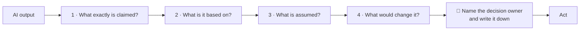

| Question | Dave's memo |
|---|---|
| Claim? | Taking every discount saves ~$42,264/yr |
| Based on? | One month × 2 % × 12 |
| Assumed? | Every vendor gives 2 % · September is normal · paying early is free |
| What would change it? | Some vendors give no discount · Brightline must borrow to pay early |
| Owner? | Dave |

- **Size the checkpoint to the decision:** lunch idea = 2 seconds · payment policy = an hour + a spreadsheet. *The harder to undo, the more checking.*
- Careful reading asks *"Do I understand this?"*; a checkpoint asks *"Is this true?"* The outputs that most need it are the ones that **look right**.
- **Works anywhere — Sara the teacher:** AI summary said "phones not allowed at any time". She searched the 4-page policy for **"except"** → phones OK at lunch + medical need anytime. Fixed before sending. Owner: Sara.

### 0.4.3 Claims, evidence and assumptions

| Kind of claim | Example from the memo |
|---|---|
| Fact | "Most distributors take every discount" |
| Prediction | "Relationships will improve" |
| Cause | "Vendors like early pay, so relationships improve" |
| Value | "The savings are large" |
| Recommendation | "Take every early-payment discount" |

| Evidence status | Do this | Memo example |
|---|---|---|
| ✅ Supported | Use it, say where the evidence is | "Q3 invoices come from 7 vendors" |
| ❓ Not supported | Treat as unknown; find evidence | "Most distributors take every discount" |
| ❌ Contradicted | Don't use; say what evidence shows | "Paying early costs nothing" (treasury: borrow at 9 %) |
| ⚖️ Uncertain | Name the check that would decide | "$176,100.25 **paid**" — file shows invoices, not payments |

- **Source strength:** original record (strongest) > summary of a record > no source (weakest).
- **A citation claims 2 things** — the source exists *and* says that. **Open it.**
- **Dates:** "When was this true?" — use web search for today's facts.
- **AI is not a strong source** — use it to *find* the original, then read the original.
- **Omissions:** look on purpose for what's missing (the memo never mentions borrowing cost).
- **Arithmetic:** numbers that drive decisions come from **code run on the original file** + you spot-check one.
- **Assumptions hide in the answer *and* the question.** "Confirm that…" pushes toward yes (**framing** + **sycophancy**). Ask neutral: *"Should we take each discount? For which vendors, and why?"*

### 0.4.4 Reasoning traps, and using AI to check AI

> 🧒 You visit a city during its one sunny week and tell everyone "the weather there is always great!" Your sample was real — just not typical.

| Trap | Check question | In the memo |
|---|---|---|
| Sample that isn't typical | Is this normal? What won't repeat? | September has a one-off **$148,500** invoice = **84 %** of the month |
| Number with no comparison | Compared with what? | — |
| Claim too wide | How many cases? Which? | "2 % from every vendor" — only **4 of 7** give any, two give only 1 % |
| Number too exact | How exact are the inputs? | $3,522.01 to the cent from a rough guess |
| Counting one side | What does it cost? | "Costs nothing" — may borrow at 9 % |
| Correlation as cause | What else changed? | |
| Confirmation bias | What would someone who disagrees show me? | |

**Traps AI makes worse:** fluency as truth · **automation bias** · **anchoring** (stuck on first answer) · **sycophancy** · **hallucination** · **generic output**.

**Using AI to check AI (red-teaming):** ask for the **strongest objection** · what would change the conclusion · start a **new chat** · ask what it **cannot know** · ask for **both sides** · **compare two models** (look where they agree, check where they disagree, ask what both missed).
**Limits:** agreement ≠ evidence (shared training) · an objection is a point to *check* · AI argues both sides well · "Are you sure?" usually repeats.

### 0.4.5 Deciding, and explaining why

> 🧒 40 % chance of rain — you still have to decide about the umbrella **now**.

| | Small loss | Large loss |
|---|---|---|
| **Easy to undo** | Decide quickly | Check the key numbers |
| **Hard to undo** | Check the assumptions | Check fully + involve the owner |

- **A good judgment** = what to decide now · what you're unsure about · the check that reduces doubt (and when) · who's responsible.
- **Waiting is a decision too.** Confidence isn't evidence.
- **Second-order effects:** pay early → save discount → use cash → **must borrow**.
- **Premortem:** "6 months later it went badly — why?" → *"We paid early and had to borrow."*
- **Decision note** (one page, recommendation first):

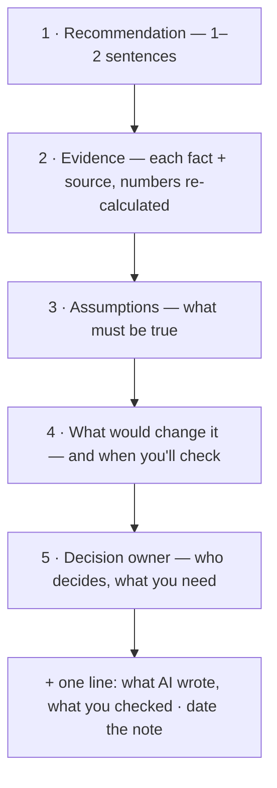

- Senior readers trust notes that **name their own weaknesses**. Details → appendix. **AI never tells you to stop** — you decide when it's ready.

### 0.4.6 Delegate the work, keep the judgment

> 🧒 If you always follow GPS, you never learn the roads — and you only notice when the signal drops.

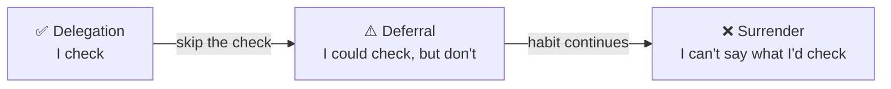

- From **Addy Osmani** (Nov 2026); "cognitive surrender" coined by **Shaw & Nave (Wharton)**. Dave was in **deferral**.
- **Shaw & Nave 2026** (~1,400 people, logic puzzles): alone **~46 %** · correct chatbot **~71 %** · **wrong chatbot ~31 %**; followed wrong advice ~**80 %** of the time and felt **more** confident. Rewards + feedback → rejected wrong advice **42 % vs 20 %**.
- **Anthropic 2026 trial** (52 engineers learning a new tool): AI group **50 %** vs no-AI **67 %** on a quiz — but AI users who *asked questions & explanations* scored much higher.
- Limits: short-term studies; long-term skill loss is a **warned-about risk, not a measured fact**.
- **Habits:** think first, then ask · estimate before calculating · explain it back · notice your reactions (*am I thinking with the AI, or is it thinking for me?*) · discuss with people · choose deliberately what to hand off. **Teams:** count checking as part of the work.

### 0.4.7 How today's tools help you check *(checked Nov 2026)*

| Helps you… | Claude | ChatGPT | Open source (Ollama) |
|---|---|---|---|
| See reasoning | Thinking section (a summary — inspect, not proof) | — | — |
| See sources | Web search citations | Deep research sources | — |
| Ground in real data | Projects & files | Projects & uploads | — |
| Fresh start | New chat | **Temporary Chat → Unpersonalized** | — |
| Second opinion | Switch model in menu | — | Local models (private; small ones err more — never the final judge) |

**The invariant:** *"A well-written answer is a draft."*

### Lab 0.4 · The discount memo (~1 h 20 min · homework — short track: Steps 1–4)

| Step | Task | Expected |
|---|---|---|
| 1 | Practice checkpoint on a sports-club summary | 3 errors: 30-day notice · joining fee not refunded · under-16s need parent signature |
| 2 | Four questions on the memo (you answer first) | ~$42,264/yr · 1 month × 2 % × 12 · 3 assumptions |
| 3 | Sort claims: kind + status | "Costs nothing" is testable; "large" is a value |
| 4 | **Code** on `q3-invoices.csv` (guess first!) | Sept **$176,100.25** · **INV-3115 $148,500 = 84 %**, no discount · **4 of 7** vendors · Q3 discounts **$814.09** · file = invoices, not payments |
| 5 | Is early payment free? Annual return = d ÷ (1 − d) × 365 ÷ (N − n) vs 9 % | 2/10 n30 **≈37 %** take · 1/10 n30 **≈18 %** take · 1/10 n60 **≈7 %** skip → worthwhile **$660.14/qtr ≈ $2,640/yr** |
| 6 | AI argues against the memo, in 2 apps | Both: not free, 1 month ≠ 1 year · neither spots INV-3115 (no file) |
| 7 | Leading vs neutral question (temporary chats) | Neutral is the safer habit |
| 8 | 7 questions → write the decision note | `brightline-decision-note.md` |
| 9 | Name the stage | You = delegation (offloading) · Dave = deferral |

**Keeper — decision note:** *Recommendation:* take 2/10 net 30 and 1/10 net 30; skip 1/10 net 60 while early payment means borrowing at 9 %. *Evidence:* Sept total, INV-3115, 4 of 7, $814.09, $660.14 — each sourced. *Assumptions:* next quarter similar, 9 % holds. *What would change it:* cash position, rate, vendor terms + review date. *Owner:* Dave. *AI line:* what AI drafted, what you checked.

> **$42,264 claimed → ~$2,640 real.** That's why judgment is the job.

---

## Exit ticket (5 min)
1. Name the model's **two** sources. Why does a new chat "forget"?
2. Why might AI miscount the r's in "strawberry"?
3. Does a tool result make an answer true? What *does* it give you?
4. You pasted AI output into a plain-text box and see `##` and `**`. What happened, and what should you have asked for?
5. Which mode: the reconciliation runs every month-end with nobody watching?
6. When AI works alone, **when** are Delegation and Description done?
7. Say the four checkpoint questions + the final step.
8. Why is September a bad month to multiply by 12?
9. "I could check, but I don't" — which stage?

Use the **Quiz** tab in [`interactive.html`](./interactive.html).

## Homework — four keeper files for your portfolio
- [ ] `ai-field-notes.md` (Lab 0.1)
- [ ] `brightline-ap-notes.md` (Lab 0.2)
- [ ] `4d-plan.md` (Lab 0.3)
- [ ] `brightline-decision-note.md` (Lab 0.4)

---

## Resources
- [Part 0 overview](https://agentfactory.panaversity.org/how-ai-works/overview/)
- **Ch 0.1** [overview](https://agentfactory.panaversity.org/how-ai-works/what-ai-actually-is/overview/) · [0.1.1](https://agentfactory.panaversity.org/how-ai-works/what-ai-actually-is/the-machine/) · [0.1.2](https://agentfactory.panaversity.org/how-ai-works/what-ai-actually-is/why-it-behaves/) · [0.1.3](https://agentfactory.panaversity.org/how-ai-works/what-ai-actually-is/from-predictor-to-worker/) · [0.1.4](https://agentfactory.panaversity.org/how-ai-works/what-ai-actually-is/both-ai-vendors/) · [Lab](https://agentfactory.panaversity.org/how-ai-works/what-ai-actually-is/lab/)
- **Ch 0.2** [overview](https://agentfactory.panaversity.org/how-ai-works/markdown/overview/) · [0.2.1](https://agentfactory.panaversity.org/how-ai-works/markdown/markdown-going-in/) · [0.2.2](https://agentfactory.panaversity.org/how-ai-works/markdown/what-comes-back/) · [0.2.3](https://agentfactory.panaversity.org/how-ai-works/markdown/one-short-specification/) · [0.2.4](https://agentfactory.panaversity.org/how-ai-works/markdown/both-ai-vendors/) · [Lab](https://agentfactory.panaversity.org/how-ai-works/markdown/lab/)
- **Ch 0.3** [overview](https://agentfactory.panaversity.org/how-ai-works/ai-fluency/overview/) · [0.3.1](https://agentfactory.panaversity.org/how-ai-works/ai-fluency/three-ways/) · [0.3.2](https://agentfactory.panaversity.org/how-ai-works/ai-fluency/the-four-ds/) · [0.3.3](https://agentfactory.panaversity.org/how-ai-works/ai-fluency/putting-them-together/) · [Lab](https://agentfactory.panaversity.org/how-ai-works/ai-fluency/lab/)
- **Ch 0.4** [overview](https://agentfactory.panaversity.org/how-ai-works/critical-thinking/overview/) · [0.4.1](https://agentfactory.panaversity.org/how-ai-works/critical-thinking/why-judgment-is-the-job/) · [0.4.2](https://agentfactory.panaversity.org/how-ai-works/critical-thinking/the-checkpoint/) · [0.4.3](https://agentfactory.panaversity.org/how-ai-works/critical-thinking/claims-evidence-assumptions/) · [0.4.4](https://agentfactory.panaversity.org/how-ai-works/critical-thinking/reasoning-traps/) · [0.4.5](https://agentfactory.panaversity.org/how-ai-works/critical-thinking/deciding-and-explaining-why/) · [0.4.6](https://agentfactory.panaversity.org/how-ai-works/critical-thinking/delegate-not-surrender/) · [0.4.7](https://agentfactory.panaversity.org/how-ai-works/critical-thinking/both-ai-vendors/) · [Lab](https://agentfactory.panaversity.org/how-ai-works/critical-thinking/lab/)
- AI Fluency Framework & Key Terminology Cheat Sheet — Rick Dakan, Joseph Feller & Anthropic (CC BY-NC-SA 4.0)

<sub>Summarised from *The AI Agent Factory* (Panaversity), Part 0, pages approved 17 Oct – 20 Nov 2026. Brightline Wholesale Supply, Dave, Ana and Sara are fictional teaching examples. Model names, plans and menus change often — verify against vendor help pages. Not accounting or financial advice.</sub>
