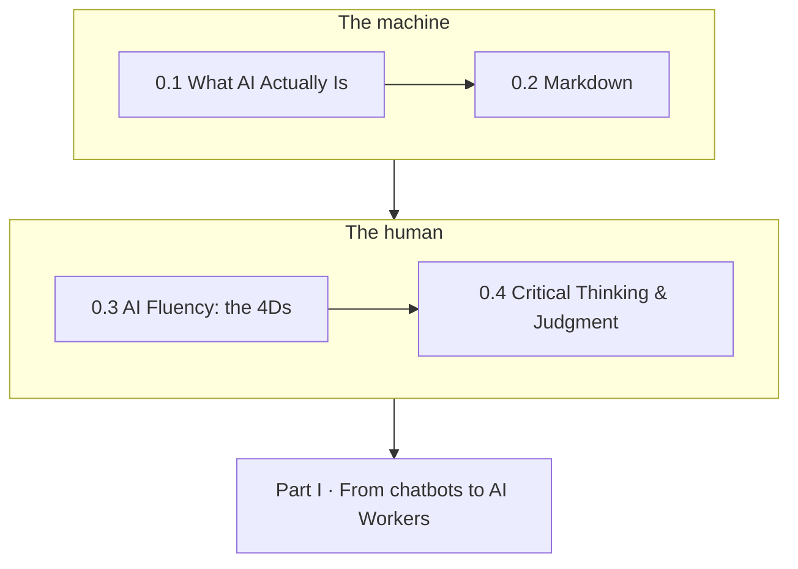

# Part 0 · How AI Works — Overview

[← Week 3 book pages](./README.md) · [Original page](https://agentfactory.panaversity.org/how-ai-works/overview/) · Approved 20 Nov 2026 · ~8 min read

> 🧒 **Like you're 10:** You've already used AI to do real jobs. Now we open the box and look at the machine inside — and learn four skills for working with it well.

## Journey summary
- **Capability:** explains the machine inside Claude and ChatGPT 2.0 and names **four skills** needed for the rest of the book.
- **Certification:** no exam here. Panaversity's **PCAO-F** exam comes after Part II.
- **Economic:** you can explain **why AI sometimes sounds right and is wrong**, and what a fluent user does about it.
- **Portfolio:** four short pieces of work, one per chapter.
- **Audience:** every route — but **optional**.
- **Before you start:** *Claude and ChatGPT 2.0* and *How to Use This Book*.
- **Next:** Part I — from chat answers to AI handling whole tasks. Parts I and II teach the four skills of Chapter 0.3 in depth.

## What this part is about
- The book's core claim: the field moved from the **chatbot paradigm** to the **AI Worker paradigm**. Winners will learn to **manage, build, govern, deploy and export** AI work.
- Part 0 explains **why AI can now handle whole tasks** and **what machine sits behind an AI Worker**. No technical background needed.
- Chapters **0.1–0.2** = the machine and the language it reads and writes.
- Chapters **0.3–0.4** = the human side: four skills and the role of judgment.

## Who can skip it
- Optional on every route. Reading ≈ **2 hours**; four labs ≈ **2 hours** more.
- Already able to explain AI's errors and how to handle them? → start at **Part I**. Otherwise start at **Chapter 0.1**.

## The four chapters
All labs use **Brightline Wholesale Supply** (from *One job, start to finish*). Its **accounts payable (AP)** work = recording, checking and paying supplier invoices.

| Chapter | What it teaches | What you make |
|---|---|---|
| 0.1 What AI Actually Is | What happens behind the text box. AI **predicts text** rather than looking up facts; **nothing inside checks truth** | **AI field notes** — test results + where each answer came from |
| 0.2 Markdown | AI writes markdown marks; the app renders them. Clean structure helps AI, but **a neat page is only as right as its lines** | A markdown page of Brightline's AP notes, each rule checked against its policy line |
| 0.3 AI Fluency: The 4Ds | **Delegation, Description, Discernment, Diligence** — from the AI Fluency Framework by Rick Dakan & Joseph Feller with Anthropic | A **4D plan** for one Brightline AP task |
| 0.4 Critical Thinking & Judgment | Why judgment becomes the core skill once AI drafts first, and the **checkpoint** habit | A Brightline **decision note**: recommendation, evidence, assumptions, what would change it, who decides |

## How Part 0 connects to Parts I and II
- 0.1 ends with how AI **uses tools and works in steps** → Chapter 1 builds on this.
- 0.3 maps each D to the chapters in Parts I and II that teach it in depth.
- Anthropic's **CCAO-F** exam guide states that the **4Ds underpin the objectives in every domain** of that exam.

## Sources
1. Anthropic, *Claude Certified Associate: Foundations Exam Guide*, v1.1, effective 7 Dec 2026.

**Next:** [0.1 What AI Actually Is →](./01-what-ai-actually-is.md)
