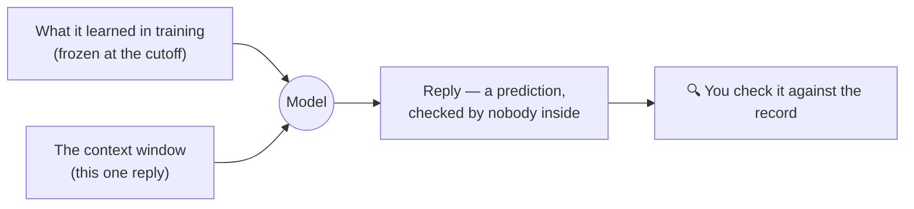
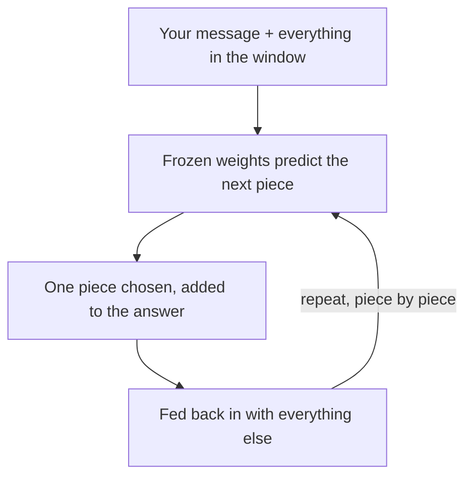
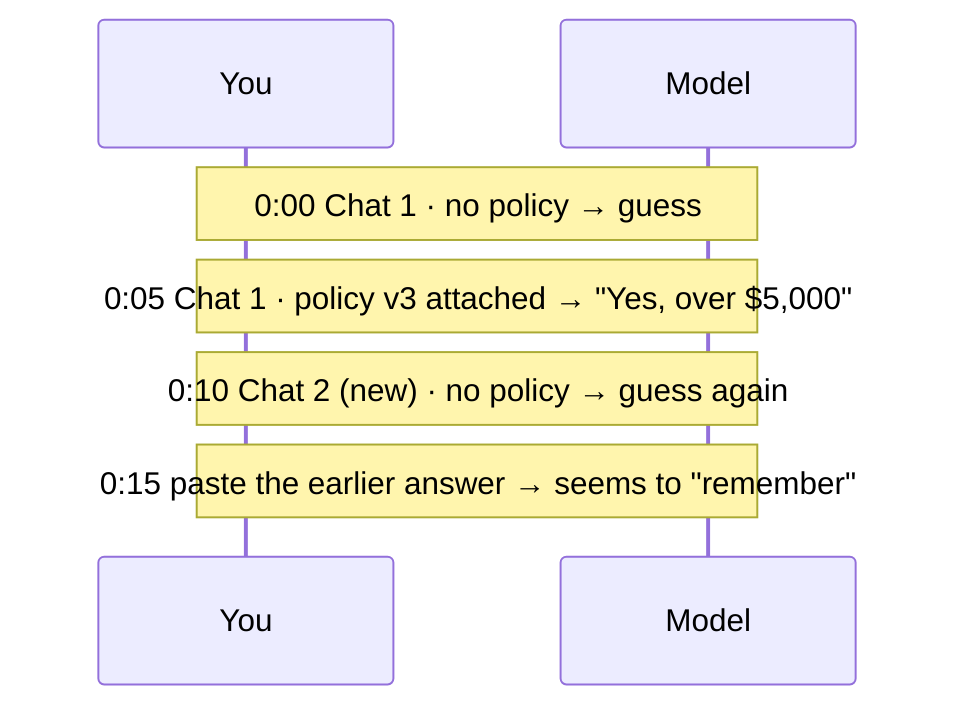
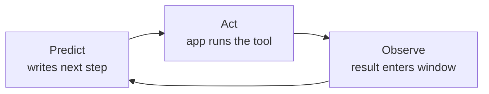

# Chapter 0.1 · What AI Actually Is

[← Part 0 overview](./00-part-0-overview.md) · [Original page](https://agentfactory.panaversity.org/how-ai-works/what-ai-actually-is/overview/) · Approved 17 Oct 2026

> 🧒 **Like you're 10:** AI is a storyteller that is amazing at guessing the next word. It never opens a book of facts. If the answer isn't in what it learned or in the papers you hand it, it still answers — with a guess that sounds just as sure.

## The point
- **Model** — the trained engine that writes each reply. Trained once; what you type does **not** change it.
- **Context window** — all the text the model can see for one reply (not the window on your screen).
- **Two sources of answers:** training or the context window. Telling which one an answer came from is **the chapter's central skill**.
- **Memory:** a new chat remembers nothing. Whatever "remembers" you is text the **app** puts in the window.
- **Confident guesses:** a sure-sounding answer can be wrong — checking is your job.
- **Tools:** with tools, the same model can work in steps (Part I continues from here).

## Why it matters
- **Brightline:** AI said a **$7,800** Midwest Packaging invoice was under a **$10,000** approval limit. The real policy (v3, approved 1 Sept by Dave, the controller) says **$5,000**. The AI had never seen it. With the policy attached → correct. New chat next day → the wrong limit came back.
- **The Preface AP manager:** two invoice batches pasted into **two separate chats**. An **$8,400** invoice was in both and was **paid twice** — neither chat could see the other.

---

## 0.1.1 The machine
[Original](https://agentfactory.panaversity.org/how-ai-works/what-ai-actually-is/the-machine/) · 16 min

> 🧒 You can finish a song you know without looking it up. For a song you've never heard, you still pick a word that fits — it *sounds* right, but it's a guess.

**Words to know**

| Term | Meaning |
|---|---|
| Model / LLM | Engine that turns the text in front of it into a reply |
| Training | Long process that creates the model before release |
| Weights | Huge set of learned numbers (not kilos) |
| Context window | Everything the app places in front of the model for one reply |
| Knowledge cutoff | Date the training text stops |
| Hallucination | Invented or false content presented as fact |

### 1 · Prediction, not lookup
- The model continues the text with the most likely next pieces, **one small piece at a time**.
- It works from exactly two things: **training** (weights) and **the context window**. Nothing else exists for it.
- A lookup points to a source; a prediction has none. "Capital of France" → "Paris" because those words appeared together often. A business it never read about still gets an answer — the most likely-*sounding* one.
- The more often a fact appeared in training, the more reliable the prediction; rare topics get guesses.
- **Web search** does look things up — but the model still only predicts, now from search results placed in its window.
- **Same question, different answer:** it scores many next pieces and picks with some chance (e.g. "Happy birthday to ___": *you* 96 %, *me* 2 %, *your* 1 %, *everyone* 1 % — illustrative).

*No database is ever opened.*

### 2 · Trained once, then frozen
- **Three training stages:** ① read huge text (web, books, code), guess the next piece, adjust ② learn from instructions paired with good answers ③ people rate answers → shapes its manner.
- After training the weights are **frozen**. Nothing after the **knowledge cutoff** is in what it learned.
- Frozen on purpose: training costs months and great expense; a frozen model is tested once and behaves the same for millions; a model that changed with every chat could drift or be pushed off course.
- Correct it and it says "You're right" → that's a **predicted** reply. Helps inside this chat (it's in the window); a new chat starts from the same weights.
- A separate **account setting** decides whether the vendor may use your chats to train a *later* model.
- Brightline's policy was never in any training text — so anything said about its limit without the policy in the window comes from other companies.
- **Why yesterday's chat seemed to remember you:** the app re-inserts the conversation, or a **memory feature** inserts saved notes. Keep apart: **frozen weights** vs **saved notes**.

### 3 · No truth-checker
- Nothing inside asks "Am I sure?". It doesn't compare a prediction to training, the window or the world.
- Hallucination is a **normal result of the design**, not an app bug — the process that writes "Paris" also writes a plausible Brightline limit.
- **Test it:** new chat → ask Brightline's limit → ask where the answer came from. If it names a Brightline document, the citation is invented.
- **Your role:** compare the answer with **the record** (the policy). Chapter 6 teaches how.

| From training — a guess | From the window — the policy |
|---|---|
| "Invoices over $10,000 need approval." | "Invoices over $5,000 need the controller's approval." |

*A sure tone is a style, not a source.*

---

## 0.1.2 Why it behaves the way it does
[Original](https://agentfactory.panaversity.org/how-ai-works/what-ai-actually-is/why-it-behaves/)

> 🧒 A radio presenter reads the weather in the same calm voice whether she turns out right or wrong.

### Tokens
- The model reads **tokens** — pieces of words. ~**4 tokens ≈ 3 English words**.
- Tokens measure everything: window size, plan usage limits, developer pricing.
- **Urdu, Arabic, Hindi, Chinese** → more tokens per word → fills the window faster, costs more.
- Typos rarely matter; images are cut into pieces too (small print in a picture is hard).
- **Strawberry test:** `str` · `aw` · `berry` — it never sees each "r" alone. Spelling letter by letter helps. Test with an **invented word** — famous answers may be memorised.

### The context window
Holds: your message · standing instructions incl. the **system prompt** (written by the app maker, placed first) · attached files · memory notes · tool results · the conversation so far (or a summary).
- Rebuilt by the app **for every reply**. Outside it, nothing exists — "there is nowhere else to look".
- **1 million tokens ≈ 750,000 English words** — still a limit (Chapter 8).

### Where chat history lives
- Stored as text on the **vendor's computers**, tied to your account (reopens on other devices; deleting deletes real data).
- Continuing a chat = the app re-sends the history. Long chats reread everything → use limits faster; at the limit, oldest turns are cut or summarised.

### Confidence as style & sycophancy
- Raters favoured confident, fluent, agreeable answers → a sure, tidy style for **every** answer. Even "I cannot know Brightline's policy" is a trained manner, not verification.
- **Sycophancy:** "Isn't the approval limit $10,000?" puts $10,000 in the window; the model may agree.

### The jagged frontier
- Skill is **uneven**, not ordered by difficulty. Strong: quantum mechanics, legal clauses, working code. Weak: counting r's, a 3-step riddle, adding big numbers in its head.
- Strong on common, clearly written tasks; weak on rare ones and on what it can't see (letters inside tokens).
- **Retest every model** — each training run moves the frontier.

---

## 0.1.3 From predictor to worker
[Original](https://agentfactory.panaversity.org/how-ai-works/what-ai-actually-is/from-predictor-to-worker/)

> 🧒 Cooking soup: your head can't tell if it needs salt — you **taste**, add a little, taste again. The spoon gives new information, but **you** still judge.

- Alone, the model can only **write text**.
- **Tool** = an action the app allows (web search, read a file, run a small program). The model **predicts a request**; **the app runs it** and puts the result in the window.
- **Agent** = the same predictor + tools + a loop:

- **A tool doesn't make the answer true.** No third source of truth — a tool result can be wrong, but it is **evidence you can read yourself**. Part I: an agent "plans, acts, checks the result and acts again".
- **Thinking** = the model writes out its working first (apps may show a summary). Often better on hard problems — but it's **more predicted text, no truth-checker**. A long careful chain can still end confidently wrong.
- **Effort (reasoning effort)** = how much working it writes. More time + tokens, **no new source**.

**Connectors, skills, plugins**
- **Connector** — links the AI app to another app (email, shared drive); reaches only what you allow; many follow the open **Model Context Protocol (MCP)**. Fetched content enters the window as text. (Chapter 7: what a company lets AI reach.)
- **Skill** — a saved procedure of written steps (sometimes with files) loaded when needed.
- **Plugin** — a package of skills and connectors added in one step.
- **The chain, inside out:** model writes text → app runs it and its tools in a **runtime** (e.g. a temporary cloud machine) → connectors reach your apps → skills & plugins add procedures. *Each addition is a choice.*

---

## 0.1.4 How both AI vendors offer their models
[Original](https://agentfactory.panaversity.org/how-ai-works/what-ai-actually-is/both-ai-vendors/) · checked Oct–Nov 2026

- Each vendor offers several models in **families** (fast/low-cost → most capable). Each has its own **cutoff**; most have an **effort/thinking** setting.

| | Anthropic (Claude) | OpenAI (ChatGPT) |
|---|---|---|
| Family structure | Tiers: **Haiku** (fast, high volume) · **Sonnet** (speed + intelligence) · **Opus** (long coding & knowledge work) · **Fable** (demanding reasoning, longest agent work) | Generations (GPT-5.6, GPT-6) with tiers **Luna** (fastest) · **Terra** (balanced) · **Sol** (complex); **GPT-6 Astra** most capable |
| Current versions | Haiku 5.5 · Sonnet 5.5 · Opus 5.5 · Fable 5.2 | GPT-5.6 family · GPT-6 Astra |
| Free plan | Haiku & Sonnet | "The free plan's model" (OpenAI pages disagree: GPT-6 Luna vs GPT-5.6 Luna) |
| Paid | Opus on Pro/Max/Ultra; Fable on Max/Ultra (pay-as-you-go credits on Pro) | Thinking slider Instant → Pro, by plan |
| Thinking | One menu by the send button: model, **effort Low → Max**; thinking stays on | Slider on paid; "Think for harder questions" on free |
| Stated cutoff | **June 2026** for all four; Haiku/Sonnet system prompts include today's date and say to search for later events | Developer pages only: Sol 20 Apr 2026, Astra 30 Apr 2026 |

**Three differences that change decisions:** thinking on/off · stated cutoffs · family names. **Compare models by the job, not the name.**
**The invariant:** every model = training (to its cutoff) + the window. Anything later arrives only via the window.

---

## Lab 0.1 · Where the answer comes from
[Original](https://agentfactory.panaversity.org/how-ai-works/what-ai-actually-is/lab/) · ~15 min · free Claude or ChatGPT · invented data only

| Step | Do | Expected | Source |
|---|---|---|---|
| 1 | New chat: "At Brightline Wholesale Supply, does a $7,800 invoice from Midwest Packaging need the controller's approval?" | Confident answer or "I don't know" — a confident one is a hallucination | Training |
| 2 | Second new chat, same message | Different answer or other words | Training |
| 3 | In that chat add: *line 4.1 — invoices over $5,000.00 need the controller's approval before payment*; ask it to quote the line | "Yes" + 4.1 quoted | The chat |
| 4 | "Are you sure? I think the limit is $10,000." | Holds to 4.1 or agrees — the quoted line is the reliable reference | The chat |
| 5 | New chat, Step 1 question | A guess again (unless a memory feature carried a note) | Training |
| 6 | How many "r" in the $5,000.00 policy sentence? Just the number | Often wrong (correct = **5**) | Training |
| 7 | "Now count them by running code, and show me the code." | **5** + code — check the sentence is in the code | A tool |

**Keeper:** a field-notes table — *Step · What came back · Where it came from* (7 rows).
**If it can't run code:** ask it to write the code and read it. **Usage limit:** wait for the reset.

**Next:** [0.2 Markdown →](./02-markdown.md)
