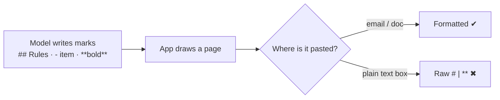
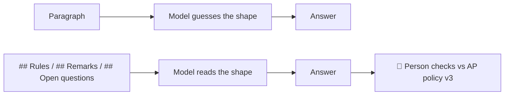
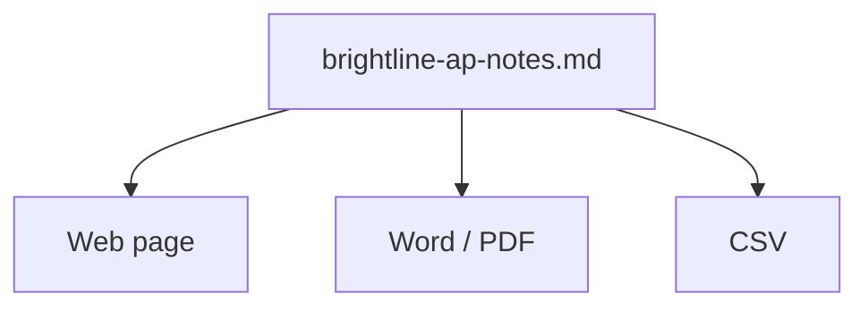

# Chapter 0.2 · Markdown: The Language AI Reads and Writes

[← 0.1 What AI Actually Is](./01-what-ai-actually-is.md) · [Original page](https://agentfactory.panaversity.org/how-ai-works/markdown/overview/) · Approved 17 Oct 2026

> 🧒 **Like you're 10:** Markdown is a few little marks — `#` for a title, `-` for a list, `**` for bold. The AI types the marks, and the app draws them as a nice page. But a nice page can still say something wrong!



## The point
- Every AI chat reply is **plain text with marks for shape** — that format is **markdown**.
- The chat app turns the marks into a formatted page. Email/document keeps the shape; a **plain text box shows the raw marks**.
- Use markdown three ways: **request the shape the next destination needs · give the AI your notes in a clear structure · keep pages to reuse.**
- **A formatted page cannot verify itself** — a wrong item looks as confident as a right one.

## Why it matters — the payment run
- **Fri 18 Sept, 4:40 p.m.** Dave must approve a payment run within 20 minutes.
- You copied the AI's payment list into the run's **note box** (plain text only). At **4:52** Dave saw raw marks: a heading, a six-row table, a bolded total of **$14,439.10**.
- He couldn't verify in time → run waited until Monday → **two invoices due that Friday were paid late**.
- You didn't ask for markdown — the AI wrote it anyway. **The destination decides** whether marks help or hurt.

**Learning outcomes:** identify the marks behind a page · request the shape a destination needs · structure notes for the AI · check a page line by line against its source · save a page for reuse.

---

## 0.2.1 Markdown going in
[Original](https://agentfactory.panaversity.org/how-ai-works/markdown/markdown-going-in/) · 12 min

> 🧒 A recipe card's title, ingredient list and numbered steps tell the cook which line is which. A card that says "two cups of salt" is followed exactly.

| Mark | Shape |
|---|---|
| `#`, `##`, `###` | Heading |
| `- item` | Bullet |
| `**text**` | Bold |
| `\| a \| b \|` | Table |
| `> text` | Quote |
| ```` ``` ```` | Code block — shows text exactly, marks included |

- A plain sentence is also markdown (no marks). Both vendors' apps format replies with marks; one has a **"Use more markdown"** setting.
- **To see the marks:** ask for the page **in a code block**.
- **Why give notes a shape?** A paragraph hides which line is a rule and which a remark. Without visible structure the model **guesses** the shape. Headings, lists or labels ("Rules:") write the shape into the text; marks reach the model as tokens. Anthropic's and OpenAI's prompting guides both recommend it.

| Shape | Use it when | What you can check |
|---|---|---|
| Headings | Notes have parts (Rules, Remarks) | Each line under the right heading |
| A list | Several items | Each item says one thing |
| A table | Facts that belong together | Each value in its own row & column |
| Quote, word for word | You need exact words | Quote matches its source |
| Source after each rule | Rule comes from a policy | Each rule names its line, e.g. *(policy 4.1)* |

- You rarely type marks — ask the AI to format under headings you name. **Your job: read and check.**
- **Neat is not checked.** A wrong rule in a tidy bullet is followed as readily — and looks *more* authoritative. Add the source to each rule; put unresolved items under **Open questions** so the model can say "unresolved" instead of guessing.



---

## 0.2.2 What comes back
[Original](https://agentfactory.panaversity.org/how-ai-works/markdown/what-comes-back/) · 9 min

> 🧒 An airline keeps **one** trip record and prints a boarding pass, a phone pass and an email receipt from it. Seat changes? They fix the record and make new copies — nobody fixes a pass by hand.

- The model writes marks; the app converts them. How many marks depends on model + settings (one vendor tells a free model to answer simple questions in plain sentences). **You can ask for more or fewer.**
- Both apps can now build parts of a reply as **charts, diagrams or buttons** — built in the app, not a text page you can check or pass on. To keep an answer: *"as a markdown page, in one code block"*.

| Next reader | Ask for | Why |
|---|---|---|
| An AI, or you later | Markdown page | Keeps shape as plain text in any app |
| A person who signs/files | Word or PDF | Prints & files; PDF looks the same everywhere |
| A spreadsheet | CSV table | One row per record, one column per value |
| A person on screen | Web page | Styled table, chart or button |

- Why AI gets markdown: web/Word layout is **extra text** to an AI — uses window space, adds **no facts**.
- **Copying:** email/doc → formatted · plain text box → raw marks · some places → shape lost. Check before sending; for a plain box ask for **plain text, no markdown**; to copy the marks, copy a code block.
- **When a fact changes:** change the **markdown page you keep**; every copy is made from it. Check each copy against the page. **Never fix a copy by hand.**



---

## 0.2.3 A copy you can check
[Original](https://agentfactory.panaversity.org/how-ai-works/markdown/one-short-specification/)

> 🧒 A print-shop order form: each line says one thing the job must have, and you tick them off.

- Notes written over time mix **rules, remarks and open questions**. A clean layout shows where each sits — not whether it's true.
- Check against the **approved source**; where the policy conflicts with the notes, **the policy governs**.

**Brightline AP notes vs policy v3 (approved by Dave)**
- Over **$5,000** needs Dave's approval → matches **4.1** ✔
- Dave considering **$10,000** next year → **Remark**, not a rule
- Weekly run → **4.3**: the controller approves every weekly payment run (no day named → "Friday" is an open question)
- Bank details: notes say reply to the email then update ✖ → **5.1**: never change bank details because of an email; call the vendor on the number already in the record. **Policy wins.**
- **Open question:** invoices in Canadian dollars. Test: a **$7,800** invoice needs Dave's approval (4.1).

**The morning:** 9:00 paste & ask · 9:04 markdown layout · 9:08 policy check · 9:10 wording fix · 9:12 open questions + file saved (`brightline-ap-notes.md`) · 9:14 web page request & check · 9:20 final check in a new chat.

**Five-line specification for the web page**
```
- Every rule in its own words, with its policy line
- Open questions under their own heading
- No remarks
- Nothing that is not on the page
- Easy to read on a phone
```
- At 9:14 one vendor's page **dropped the open question** → failed line 2 → re-requested.
- "Make it look good" can't be checked — a bad copy passes it. Make each line checkable in about a minute.
- This book's briefs, review contracts, records, labs and answer keys are all markdown. Nobody has *approved* the AP page yet — Chapter 8 covers that.

---

## 0.2.4 The same marks on both AI vendors
[Original](https://agentfactory.panaversity.org/how-ai-works/markdown/both-ai-vendors/) · Claude checked 18 Nov, ChatGPT 16 Oct 2026

> 🧒 Two phones show the same text message in different fonts and bubbles.

| Topic | Claude | ChatGPT |
|---|---|---|
| Formatting | Ask for more/less; set in user preferences | Personalization → Headers & Lists ("Use more/less markdown") |
| Fewer visuals | Ask for less formatting | Personalization → Layout and Visuals → Simple |
| Keep a page | **Claude Doc** (plain words or `/docs`), every plan; export .md, Word, PDF, Google Docs | Copy code block into a `.md` file; writing blocks → Library; deep research → Markdown/Word/PDF |
| Web page | **Artifact** beside the chat (Artifacts tab) | HTML code block + **Preview** |
| Non-text | Custom visuals (beta) — not saved unless you save them | Intelligent UI (GPT-6): buttons, forms, charts |

- Neither vendor's help says what the **Copy** button copies — check what you pasted.
- **The marks are the same; only buttons differ.**

---

## Lab 0.2 · One page, checked
[Original](https://agentfactory.panaversity.org/how-ai-works/markdown/lab/) · ~20 min · `brightline-lab-ch0-3.zip` → `invoices-this-week.csv`, `ap-notes.txt`, `ap-policy-v3.pdf` · a plain text editor

1. Attach the CSV; ask for invoices due on/before **18 Sept 2026** — table (vendor, invoice, amount), heading, bold total → 6 invoices, **$14,439.10**.
2. Copy → paste into an email and a plain text editor → formatted vs raw `#`, `|`, `**`.
3. Ask for **plain text for a note box, no markdown** → one invoice per line, no marks.
4. New chat: paste `ap-notes.txt`; organise under **Rules · Remarks · Open questions** → $10,000 under Remarks, CAD under Open questions.
5. Attach the policy; match each rule to a line → $5,000 = 4.1; bank details **contradict 5.1**; no line names Friday.
6. Fix: rewrite bank rule with 5.1 wording, add *(policy 5.1)* and *(policy 4.1)*, move payment day to Open questions, output as **one code block**. Remove any line the AI adds.
7. Save as **`brightline-ap-notes.md`** (TextEdit: Make Plain Text; Notepad: All files).
8. New chat, attach the page only: $7,800 → **Yes (policy 4.1)**; Canadian dollars → still open.

**Keeper:** `brightline-ap-notes.md`. *Troubleshooting:* no `#` signs → ask "as a markdown page, inside one code block"; ChatGPT free = 3 uploads/day (this lab uses 3).

**Next:** [0.3 AI Fluency: The 4Ds →](./03-ai-fluency-4ds.md)
