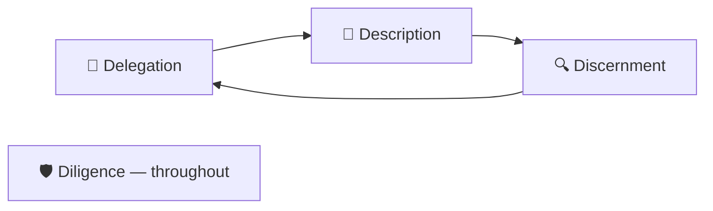
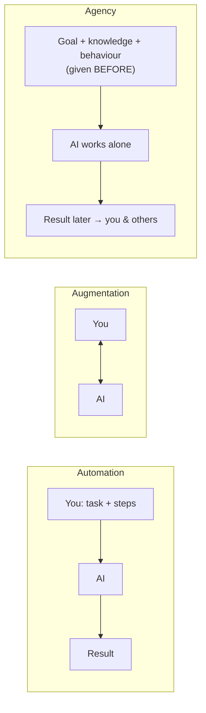
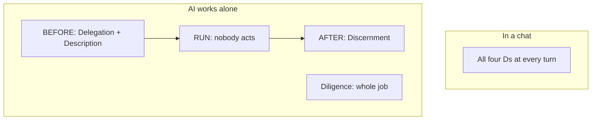

# Chapter 0.3 · AI Fluency: The 4Ds

[← 0.2 Markdown](./02-markdown.md) · [Original page](https://agentfactory.panaversity.org/how-ai-works/ai-fluency/overview/) · Approved 20 Nov 2026 · ~6 min

> 🧒 **Like you're 10:** Leaving your little brother with a babysitter: you **decide** what she does, you **write the rules** before you go, you **check** in the morning, and you **take responsibility** for the evening. Those are the 4Ds.



## The point
- **AI fluency** = working with AI **effectively, efficiently, ethically and safely**. *"AI access is not AI fluency."*
- **The 4Ds:** Delegation · Description · Discernment · Diligence — from the **AI Fluency Framework** by **Rick Dakan & Joseph Feller with Anthropic** (CC BY-NC-SA 4.0). Each D has three parts.
- **Run** = one time the AI does a job start to finish; it only has what was written down before it began.
- **Reconcile** = compare two records of the same money and explain where they differ.

## Why it matters — reconciling Buckeye Office Supply
- **Tue 1 Sept, 2:00 p.m.** You reconcile Buckeye's August statement against Brightline's register.
- **2:05** AI returns a table that "matches" every line by **changing the register** to the vendor's figures ✖ — breaks policy **7.4**: *"Never change the register to match a vendor statement."*
- Fix: **"explain, change nothing"** + a question about one unclear line.
- **2:20** corrected table reaches Dave, **with a note that AI drafted it**.
- **The 4Ds stay the same; their *timing* changes when AI runs a job unattended.** Maria (Preface): *"She has stopped doing the work and started managing it."*

---

## 0.3.1 Three ways to work with AI
[Original](https://agentfactory.panaversity.org/how-ai-works/ai-fluency/three-ways/)

> 🧒 Dinner three ways: give a cook a recipe · cook together with a friend, tasting as you go · hire a cook for evenings you're at work, who may feed guests before you're home.

| Mode | Definition | Who picks the next step | Are you there? | Brightline |
|---|---|---|---|---|
| **Automation** | AI carries out a specific task from your specific instructions | You, in your instructions | When you ask + when the result returns | Put each statement line in a table |
| **Augmentation** | You and AI as thinking partners | You and AI, turn by turn | At every turn | Work out why one difference doesn't add up |
| **Agency** | You set AI up to work on its own, on your behalf, on later tasks (may deal with people or other AIs) | The AI, inside what you set up | No — result reaches you/others later | Reconciliation runs each month-end |

- Automation ≠ a job that runs unattended on a schedule — that's **agency**.
- In automation/augmentation you can correct each answer; in agency **everything you give comes before the work starts**.
- **Ladder:** chatbots → automation/augmentation; agents & AI Workers → agency. *"Agents are delegated tasks. AI Workers are managed."* (Chapter 1)
- **A mode does not grant permission.** What an AI Worker may do is decided action by action (Chapter 7). The monthly run is agency — and may still change nothing at all.



---

## 0.3.2 The four Ds
[Original](https://agentfactory.panaversity.org/how-ai-works/ai-fluency/the-four-ds/)

> 🧒 Babysitter: set rules in advance, the sitter works without you, you check the next morning.

**When the AI works alone, nobody acts during the run — each D happens before it, after it, or not at all.**

### Delegation — who does what
- Decide which work people do, which the AI does, how to split it. Needs your goal, what AI systems can/can't do, task-by-task decisions.
- Done **before** the work; when AI works alone, **written before the first run** — incl. what waits for a person (e.g. register corrections). In the chat, you changed the split at 2:05.

### Description — say it clearly
- Specify **what you want back · how to approach it · how to behave**.
- In a chat you add details as you go; alone, it's **finished before the first run** and stored where every run reads it (e.g. project instructions). A run has **no next turn**.
- Behaviour is written in advance — incl. when unsure: *"the statement does not show"* instead of guessing.

### Discernment — judge the result
- Judge what AI produced, how it got there, how it behaved. Chat: each answer as it arrives. Alone: **after each run at a set time**.
- The run's self-check doesn't replace yours. Judge from **the output · the run's record** (files read/written) **· the source** (statement, register, invoices).
- A mistake that recurs monthly = a **process** problem. Chapter 6 teaches reading a run's record.

### Diligence — responsible & honest
- Choose carefully how you use AI and what goes in · be honest about AI's part · take responsibility for what you use or share.
- Three jobs: **before** (plan states use + inputs) · **with the output** (honest AI statement travels with it) · **after each run** (someone **signs**).
- Discernment *judges*; signing *takes responsibility*. Everyone who relies on the work must know AI was involved — Dave signs; **auditors** may rely on it later. Chapter 10 covers telling people.

### The twelve parts

| D | Part 1 | Part 2 | Part 3 |
|---|---|---|---|
| Delegation | **Problem awareness** — goal & kind of work | **Platform awareness** — what systems can/can't do | **Task delegation** — task by task |
| Description | **Product** — format, audience, style | **Process** — steps to follow | **Performance** — brief/detailed, challenging/supportive |
| Discernment | **Product** — accuracy, relevance, coherence | **Process** — logic errors, missed items, extra steps | **Performance** — behaviour & communication |
| Diligence | **Creation** — which systems, what goes in | **Transparency** — honest about AI's part | **Deployment** — check & stand behind it |

**Operating rule (Preface):** humans define intent → AI Workers execute → humans verify outcomes.



---

## 0.3.3 Putting the 4Ds together
[Original](https://agentfactory.panaversity.org/how-ai-works/ai-fluency/putting-them-together/)

> 🧒 On a mountain trip you can't buy what you forgot — write the packing list before you leave, add what you missed afterward.

- The 4Ds form one repeating **4D loop**: delegate, describe, discern, go round again; stay diligent throughout.
- **In a chat** the loop ran in ~20 minutes with you at every turn.
- **Nobody watching:** it spreads over days; a person acts only at the two ends — **writing the plan** and **checking results**.

```mermaid
timeline
    title Monthly vendor-statement reconciliation
    Mon 24 Aug 9:00 : Dave writes the 4D plan (markdown)
    Tue 1 Sep 2:00 pm : Run starts on its own, unwatched → table + record
    Wed 9:00 am : Dave reads table + record, checks 2 differences vs invoices
    Thu 3 Sep : Deadline — Dave signs
```

| D | Dave's plan line | When |
|---|---|---|
| Delegation | Compare statement with register, explain every difference. **Change nothing, contact nobody.** Every correction waits for Dave | Before first run |
| Description | One row per difference, amount + reason; no reason → *"the statement does not show"* | Before first run |
| Discernment | Next morning 9:00, read table + run record, check two differences against invoices | After each run |
| Diligence | Only statement + register go in; table states AI made it; nothing reaches Buckeye until Dave signs | Throughout |

- If a check fails → Dave **fixes the page** before the next run. The plan is written once; every run reads it.

**Four beginner mistakes = a missing D**

| Mistake | Missing D | In a chat | In a run |
|---|---|---|---|
| Typing before deciding the job | Delegation | You stopped the 2:05 table | No "change nothing" line → differences removed |
| Weak first answer taken as final | Description | You added what was missing | What the page leaves out, the table leaves out |
| Trusting a tidy answer | Discernment | You checked a row vs its invoice | Unread, it enters the accounts |
| Data & responsibility thought of too late | Diligence | You left out what wasn't needed, told Dave | No signer → nobody owns the table |

**Daily checklist:** Delegation — goal? what alone, what waits? · Description — output, steps, behaviour? · Discernment — how will I know it's right and how it was made? · Diligence — what goes in, who must know, who signs?
**Setup check before AI works alone:** right account · access to what the job needs **and no more** · where the result goes · which actions ask you first.
**Go deeper:** Delegation → Ch 7, 9 · Description → Ch 5, 8 · Discernment → Ch 6, 11 · Diligence → Ch 10 · Chapter 3: one rhythm — your parts come before the AI starts and after it finishes.

---

## Lab 0.3 · Your 4D plan, before the run
[Original](https://agentfactory.panaversity.org/how-ai-works/ai-fluency/lab/) · ~15 min · two temporary chats (Claude: ghost icon; ChatGPT: dashed circle → Unpersonalized)

1. **Sort three jobs** (AI quizzes you): invoice numbers → table = *automation* · why a balance doesn't match, back and forth = *augmentation* · check every statement monthly, unwatched = *agency*.
2. **Decide the 4D plan** for: *every Monday 7:00, table of invoices due that week from the register*. One D at a time, your words only, a "when" per line, end with a **D · line · when** table. Delegation keeps register changes & vendor contact with a person; Description covers missing data ("no due date"); Discernment names a person + time; Diligence names inputs, disclosure, signer.
3. **Name the next D:** amounts but no dates → Description · daily filing, no decision on moving files → Delegation · late-payments table, no signer/disclosure → Diligence · "County Freight owes $2,980.00", about to copy → Discernment.
4. **Test the Description line** (today = Mon 31 Aug): Midwest Packaging $1,240.00 due 4 Sept · Buckeye $310.50 received 6 Aug · County Freight $2,980.00 due 15 Sept. With the line → Buckeye = **"no due date"**; without → may guess. Both name Midwest Packaging.
5. **Keep it:** markdown page in one code block → **`4d-plan.md`**.

**Next:** [0.4 Critical Thinking and Judgment →](./04-critical-thinking.md)
