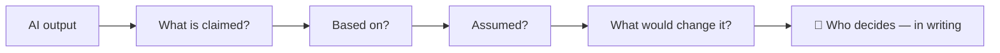

# Chapter 0.4 · Critical Thinking and Judgment in the AI Era

[← 0.3 AI Fluency](./03-ai-fluency-4ds.md) · [Original page](https://agentfactory.panaversity.org/how-ai-works/critical-thinking/overview/) · Approved 20 Nov 2026 · ~6 min

> 🧒 **Like you're 10:** You type 12 × 5 instead of 12 × 50 and the calculator instantly says 60. It's fast and sure — but **noticing that 60 can't be right is your job.**

## Core idea
AI writes a confident first draft in seconds, so **judging whether it's right** becomes the valuable part of the work.

**Six skills:** tell a claim from its evidence · find assumptions in a question and its answer · notice traps · use AI to find weaknesses in its own answer · decide when you can't be certain · explain your decision on one page.

**Why it matters:** a 2026 experiment — people with a sometimes-wrong chatbot got **~31 %** right vs **~46 %** alone, and felt **more** confident · a model sounds the same right or wrong · **PwC** is training **85,000+** people in this skill · 0.3 introduced Discernment & Diligence; this chapter teaches the thinking behind them.

**Running case:** Dave asks AI to confirm paying every vendor early for small discounts; memo promises **~$42,264/yr**. Ana asks for **five minutes** before it goes to the CFO — the lab has you do her job with the real invoice data.

**Time:** short track = 0.4.1–0.4.3 + lab Steps 1–4 · full = 7 lessons + ~1 h 20 min lab.

---

## 0.4.1 Why judgment is the job
[Original](https://agentfactory.panaversity.org/how-ai-works/critical-thinking/why-judgment-is-the-job/)

> 🧒 Phones store every number, so we stopped memorising them — fine. Losing the ability to tell if the number on the screen is right — not fine.

- Drafts are cheap; **fluent, confident writing is not evidence**. If nobody judges the output, nobody did the job.
- Ana, AP analyst: earlier analysts learned by building reports line by line; AI now builds them in a minute, so new staff lose that learning path.
- Judge a draft: **Is it true? Does it answer the question that matters? What's missing? What next, and who decides?**
- **Critical thinking** = what's true vs only claimed · **Judgment** = the final decision with stated reasons, often without certainty · **Opinion** = a reaction without stated reasons.

**Employers:** PwC US (Nov 2026) — Critical Thinking & Judgment certificate for 85,000+ people by June 2027 (practice: review a convincing but possibly incomplete AI tax analysis) · IBM 2026 (1,500 CHROs) — **71 %** name supervising, checking and overriding AI output the most needed AI skill; ~6 in 10 employees worry AI weakens their skills.

**Can it be taught?** The **method** yes (real but modest gains, biggest with real problems + a mentor). Judgment depends on **subject knowledge** — finance checking doesn't transfer to medicine. Needs regular patterns and practice; confidence ≠ accuracy; probability training improved forecasts.

**Cautionary cases:** *Mata v. Avianca* (NY, 2023) — lawyers filed ChatGPT-invented cases; ChatGPT said they were real; **$5,000** penalty · *Moffatt v. Air Canada* (2024) — website chatbot promised a bereavement refund the policy didn't allow; airline held responsible (~C$812).

**The memo's vocabulary:** early-payment discount · **2/10 net 30** = 2 % off within 10 days, else full amount in 30 · line of credit at **9 %/yr** · payment run = Friday · Q3 = Jul–Sep · 2/10 net 30 ≈ **36–37 %/yr**.

**The memo:** take every discount from the 6 Nov run, because ① Sept payments **$176,100.25 × 2 % = $3,522.01/month ≈ $42,264/yr** ② standard practice ③ costs nothing ④ all seven vendors will be happier.

---

## 0.4.2 The checkpoint
[Original](https://agentfactory.panaversity.org/how-ai-works/critical-thinking/the-checkpoint/) · 7 min

> 🧒 Pilots use a checklist before every takeoff — even on clear days, after thousands of flights.

A **checkpoint** = a planned stop after you get an AI output and before you act on it.

| Question | Look for | Dave's memo |
|---|---|---|
| 1 · What exactly is claimed? | The statement you'd act on, in one sentence. Check the words ("sales" = orders or cash?) | ~$42,264 a year saved |
| 2 · What is it based on? | Evidence — can you see it? | One month × 2 % × 12 |
| 3 · What is assumed? | Unstated things that must be true | Every vendor gives 2 % · Sept is normal · paying early is free |
| 4 · What would change it? | The fact that would flip the answer — **then check it** | Some vendors give no discount · Brightline must borrow |
| → Decision owner | Who decides, and what you recommend — **in writing** | Dave |

- Size it to the decision: lunch idea ≈ 2 seconds; payment policy ≈ an hour + a spreadsheet. **The harder to undo, the more checking.**
- Careful reading asks *"Do I understand this?"*; a checkpoint asks *"Is this true?"* The outputs that most need it are the ones that **look right**.
- **Sara the teacher:** AI summary said phones are not allowed at any time. Searching the 4-page policy for **"except"** found two exceptions (lunch; medical need). Fixed before sending. Owner: Sara. *The topic changed; the four questions didn't.*

---

## 0.4.3 Claims, evidence and assumptions
[Original](https://agentfactory.panaversity.org/how-ai-works/critical-thinking/claims-evidence-assumptions/)

> 🧒 A shop says the phone battery lasts two days (claim). A test report — or two days of your own use — is the evidence.

| Kind | Says | Memo example |
|---|---|---|
| Fact | What is/was true | "Most distributors take every discount" |
| Prediction | What will happen | Relationships will improve |
| Cause | Why | Vendors like early pay, so relationships improve |
| Value | Good/bad | "The savings are large" |
| Recommendation | What to do | Take every discount |

| Status | Meaning | Do | Memo example |
|---|---|---|---|
| Supported | You've seen evidence | Use it, say where | 7 vendors in Q3 (file lists seven) |
| Not supported | No evidence yet | Treat as unknown | "Most distributors…" (no source) |
| Contradicted | Evidence says otherwise | Don't use; say what it shows | "Costs nothing" (treasury: 9 % credit line) |
| Uncertain | Evidence doesn't decide | Name the deciding check | "$176,100.25 **paid**" — check what the file shows |

- **Source strength:** original record > summary of a record > no source.
- **A citation claims two things** — the source exists and says that. Open it.
- **Dates:** ask *when was this true?*; enable web search for today's facts.
- **AI is not a strong source** — use it to find the original, then read the original.
- **Omissions:** look on purpose (the memo never mentions borrowing cost).
- **Arithmetic:** run **code on the original file**, show the rows, check one number yourself.
- **Assumptions** hide in the answer (every vendor, typical month, free cash) **and in the question** — "Confirm that…" pushes toward yes (**framing** + **sycophancy**).
- Find them: *"For this to be true, what else must be true?"*; ask the AI "what did you assume?" then answer from the opposite starting point.
- **Neutral questions:** "Should we take each discount? For which vendors, and why?" · "Give the strongest argument for and against." · "We haven't checked the cash — how would that change it?"

---

## 0.4.4 Reasoning traps, and using AI to check AI
[Original](https://agentfactory.panaversity.org/how-ai-works/critical-thinking/reasoning-traps/)

> 🧒 You visit a city in its one sunny week and say "the weather there is always great". Your sample was real — just not typical.

| Trap | Check | In the memo |
|---|---|---|
| Sample not typical | Is it normal? What won't repeat? | One **$148,500** no-discount invoice = **84 %** of Sept; one-time leased equipment |
| Number with no comparison | Compared with what? | — |
| Claim too wide | How many cases? Which? | Only **4 of 7** vendors give any discount; two give 1 % |
| Number too exact | How exact are the inputs? | $3,522.01 to the cent from a rough guess |
| Counting one side | What does it cost? | Paying early can mean borrowing at 9 % |
| Correlation as cause | What else changed? | — |
| Confirmation bias | What would someone who disagrees show me? | — |

**Traps AI makes worse:** fluency as truth (judge evidence, not writing) · automation bias (when you doubt, check) · **anchoring** (new chat / ask for options first) · sycophancy (neutral question, then the case against) · hallucination (ask for the source, open it) · generic output (ask what it misses about your case).

**Using AI to check AI:** Ana asked a new chat for the **three strongest reasons the memo could be wrong** + what data would answer each → one-month sample, differing discount rates, cost of cash.
- Ask for the **strongest objection** (**red-teaming**) · what would change the conclusion · start a **new chat** · ask what it **cannot know** · ask for **both sides** · **compare two models** — look where they agree, check where they disagree, ask what both missed.
- **Limits:** agreement isn't evidence (shared training) · an objection is a point to check · AI argues either side well · "Are you sure?" usually repeats. Same limits apply when AI Workers check each other (Part III) — a person still owns the decision.

---

## 0.4.5 Deciding, and explaining why
[Original](https://agentfactory.panaversity.org/how-ai-works/critical-thinking/deciding-and-explaining-why/) · 10 min

> 🧒 40 % chance of rain — you still decide about the umbrella now.

| | Small loss | Large loss |
|---|---|---|
| **Easy to undo** | Decide quickly | Check the key numbers |
| **Hard to undo** | Check the assumptions | Check fully, involve the owner |

- **Reversibility** (one run's discount vs a three-year contract) × **stakes** ($26 discount vs $148,500 payment).
- **A good judgment:** what to decide now, sized to the evidence · what you're unsure about and how much it matters · the check that reduces doubt and when · who's responsible. *Brightline:* take discounts worth more than 9 %, skip the rest, review after three months, Dave decides.
- **Waiting is a decision too.** Confidence isn't evidence. Slow down: what happens next? what after that (**second-order effect**: pay early → use cash → borrow)? what would I tell a colleague?
- **Premortem:** six months on, it went badly — why? → *"We paid early and had to borrow."*

**The decision note (one page, recommendation first)**

| Part | Contains |
|---|---|
| Recommendation | 1–2 sentences: what to do |
| Evidence | Key facts with sources; numbers **recalculated, not copied** |
| Assumptions | What must be true |
| What would change it | Facts that flip it + when you'll check |
| Decision owner | Who decides, what you need from them |

- Start with the recommendation, keep evidence short and checkable, **state uncertainty plainly** (senior readers trust notes that name their weaknesses), details in an appendix, **date the note**.
- **Mention AI:** what it wrote and what you checked — e.g. *an AI assistant drafted the first memo; code re-ran its numbers on the Q3 export, and I checked them against the file.* Follow your organisation's AI policy first.
- AI will always suggest another change and never tell you to stop — **you decide when it's ready**.

---

## 0.4.6 Delegate the work, keep the judgment
[Original](https://agentfactory.panaversity.org/how-ai-works/critical-thinking/delegate-not-surrender/)

> 🧒 Always follow the GPS and you never learn the roads — until the signal fails.

| Stage | What happens | Test |
|---|---|---|
| ✅ Delegation | AI does the work; you own and check the conclusion | You can say what you checked |
| ⚠️ Deferral | You accept the output without doubting it | You could name a check but don't do it |
| ❌ Surrender | The AI's answer becomes yours | You can't say what you'd check |

- From **Addy Osmani** (Claude Code team, Nov 2026); "cognitive surrender" coined by **Steven Shaw & Gideon Nave** (Wharton). Dave was in **deferral**.
- **Shaw & Nave 2026:** 3 experiments, ~1,400 people. Exp. 1 (440): alone **~46 %**, correct chatbot **~71 %**, wrong chatbot **~31 %**; followed wrong advice ~**80 %** of the time; felt more confident. Small rewards + feedback → rejected wrong advice **42 % vs 20 %**.
- **Anthropic 2026 trial:** 52 mostly early-career engineers learning a coding tool — AI group **50 %** vs **67 %** on a quiz; those who used AI to ask questions scored much higher than those who let it do the whole task.
- **Limits:** short-term, small samples — long-term skill loss is a **warned-about risk, not a measured fact**. *A person who hasn't built a skill can't use it when the AI is wrong.*

**Keep your judgment:** delegate cheap-mistake decisions, keep expensive ones · accountability can't be delegated · read the **actual output** (file, number, test, log) before the summary · define "checked" before the work.
**Habits:** think first, then ask · estimate before calculating (≈40 invoices before counting 43) · explain it back · notice your reactions (*am I thinking with the AI, or is it thinking for me?*) · discuss with people · choose deliberately what to hand off.
**Teams:** people practise what gets measured — count checking as part of the work.

---

## 0.4.7 How today's tools realize it
[Original](https://agentfactory.panaversity.org/how-ai-works/critical-thinking/both-ai-vendors/) · Claude 18 Nov, ChatGPT/open source 11 Nov 2026

| | Claude | ChatGPT | Open source (Ollama) |
|---|---|---|---|
| Reasoning | **Thinking** section — inspect, not proof | — | — |
| Sources | Web search citations | Deep research sources | — |
| Your data | Projects & files | Projects & uploads | — |
| Fresh start | New chat; switch models in the menu | **Temporary Chat → Unpersonalized** (Personalized still uses memory) | Run a different local model |
| Privacy | — | Temporary Chat not saved in history | Local = prompts stay on your computer; **cloud models** go to servers; download only from the official site; small models err more — never the final judge |

**Invariant:** *"A well-written answer is a draft."* Decision numbers come from code on the original file.

---

## Lab 0.4 · The discount memo
[Original](https://agentfactory.panaversity.org/how-ai-works/critical-thinking/lab/) · ~1 h 20 min · `brightline-lab-ch0-5.zip` → `discount-memo.md`, `q3-invoices.csv`

| Step | Task | Expected |
|---|---|---|
| 1 · 5 min | Practice on a sports-club summary | 3 errors: 30-day notice · joining fee not refunded · under-16s need a parent's signature |
| 2 · 5 min | Four questions on the memo, no AI view first | ~$42,264/yr · 1 month × 2 % × 12 · three assumptions |
| 3 · 5 min | Sort claims (kind + "not checked yet") | "Costs nothing" is testable; "large" is a value |
| 4 · 15 min | Guess, then code on the CSV + spreadsheet + one calculator check | Sept **$176,100.25** · **INV-3115 $148,500 = 84 %**, no discount · invoices, not payments · **4 of 7** · Q3 discounts **$814.09** |
| 5 · 10 min | Treasury note ($60,000 minimum cash, 9 % line, INV-3115 one-time). Return = d ÷ (1 − d) × 365 ÷ (N − n) | 2/10 n30 **≈37 %** take · 1/10 n30 **≈18 %** take · 1/10 n60 **≈7 %** skip → **$660.14/qtr ≈ $2,640/yr**; $42,264 not supported; "costs nothing" contradicted |
| 6 · 15 min | AI argues against the memo in two apps | Both: not free, one month ≠ a year; neither spots INV-3115 |
| 7 · 5 min | Leading vs neutral question (temporary chats) | Neutral is the safer habit |
| 8 · 15 min | Seven questions → note | `brightline-decision-note.md` |
| 9 · 3 min | Name the stage | You = delegation · Dave = deferral |
| Optional | Find 3 published sources on discount-taking | Real & accurate / real but misdescribed / not found |

**Keeper — decision note:** *Recommendation:* take 2/10 net 30 and 1/10 net 30; skip 1/10 net 60 while early payment means borrowing at 9 %. *Evidence:* Sept total, INV-3115, 4 of 7, $814.09, $660.14 — each sourced. *Assumptions:* next quarter similar; 9 % holds. *What would change it:* cash, rate or vendor terms + review date. *Owner:* Dave. *AI line:* what AI did, what you checked.

> **$42,264 claimed → ≈ $2,640 real.**

[← Back to Week 3 book pages](./README.md)
