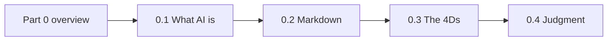

# Week 3 · Book pages — Part 0: How AI Works

Lesson-by-lesson study notes for the five book pages of Week 3, so the class can read everything inside this repo.
Each file follows every sub-page of its chapter and ends with the lab and a link to the original page.

| # | Book page | Notes in this repo | Original |
|---|---|---|---|
| 1 | Part 0 · How AI Works | [00-part-0-overview.md](./00-part-0-overview.md) | [link](https://agentfactory.panaversity.org/how-ai-works/overview/) |
| 2 | 0.1 What AI Actually Is | [01-what-ai-actually-is.md](./01-what-ai-actually-is.md) | [link](https://agentfactory.panaversity.org/how-ai-works/what-ai-actually-is/overview/) |
| 3 | 0.2 Markdown: The Language AI Reads and Writes | [02-markdown.md](./02-markdown.md) | [link](https://agentfactory.panaversity.org/how-ai-works/markdown/overview/) |
| 4 | 0.3 AI Fluency: The 4Ds | [03-ai-fluency-4ds.md](./03-ai-fluency-4ds.md) | [link](https://agentfactory.panaversity.org/how-ai-works/ai-fluency/overview/) |
| 5 | 0.4 Critical Thinking and Judgment in the AI Era | [04-critical-thinking.md](./04-critical-thinking.md) | [link](https://agentfactory.panaversity.org/how-ai-works/critical-thinking/overview/) |

Study notes summarised from *The AI Agent Factory* (Panaversity), Part 0, pages approved 17 Oct – 20 Nov 2026. Read the original pages for the full text, figures and quizzes. Brightline Wholesale Supply and its people are fictional. Model names, plans and menus change often.
